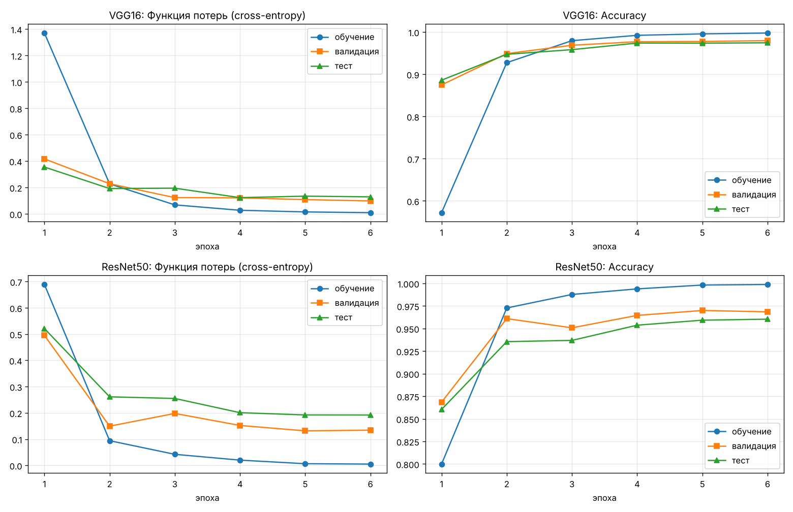
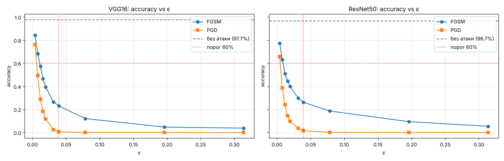
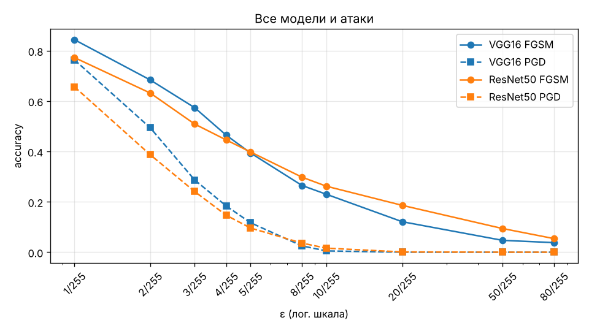
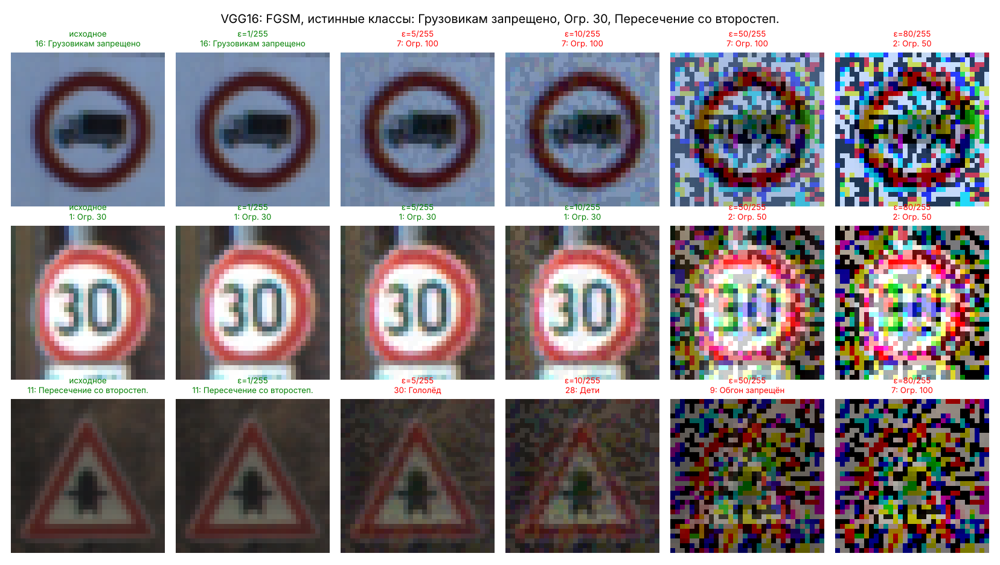
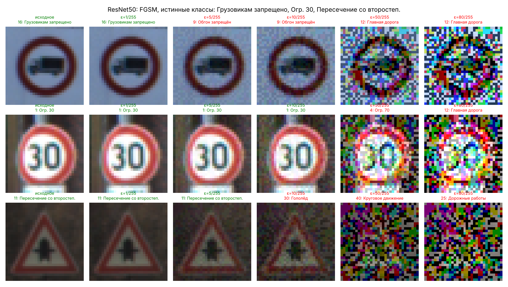
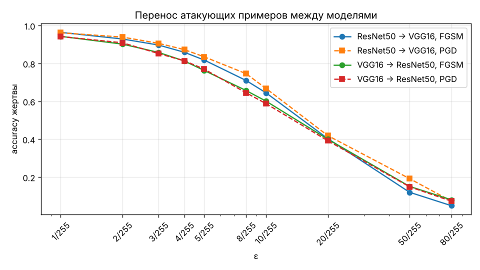
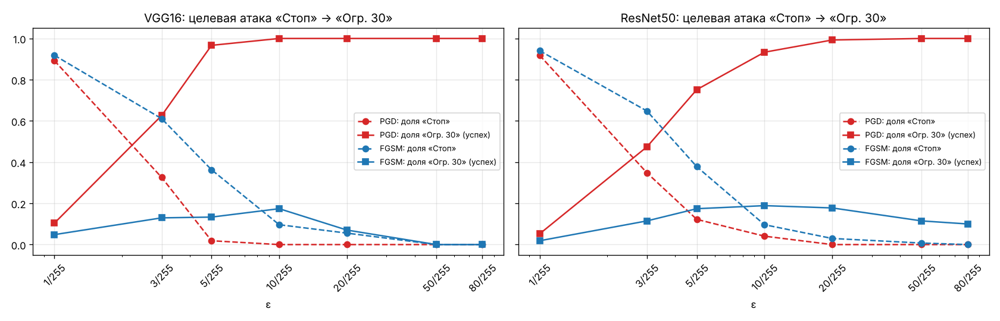
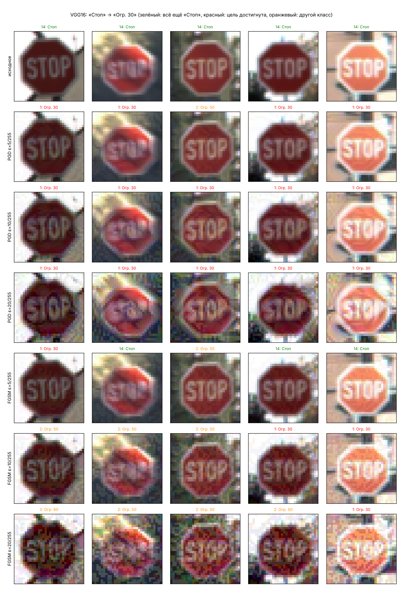
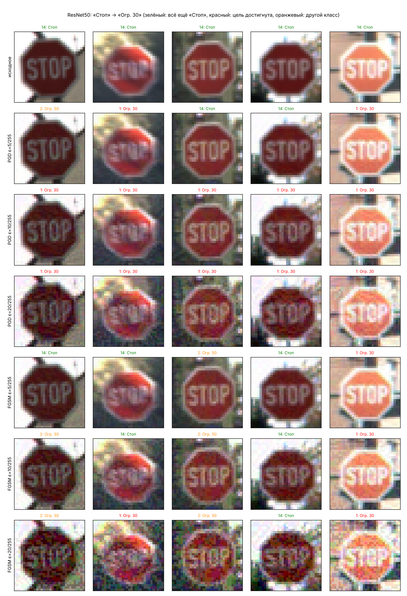
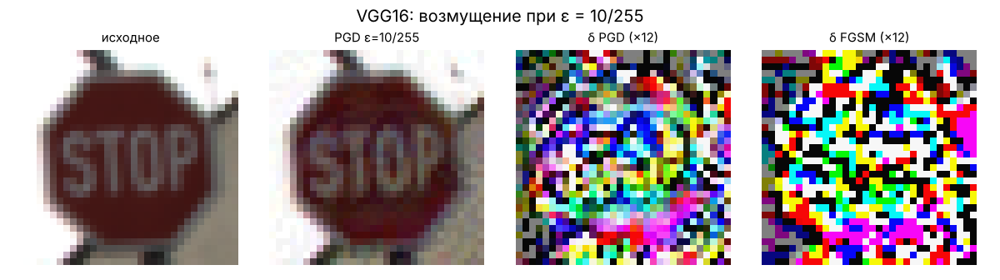

# ЛР2 АЗСИИ: подробный гайд для начинающего

> Атаки уклонения **FGSM** и **PGD** (белый ящик) на классификаторы дорожных знаков **VGG16** и **ResNet50**,
> целевая атака «Стоп» → «Ограничение скорости 30» и перенос атак между моделями (чёрный ящик).

В гайде разобрано всё, что происходит в лабораторной: о чём задание, что нужно знать заранее, как устроены
датасет, модели и атаки, что делает каждый блок ноутбука, где легко ошибиться, как читать результаты и что
отвечать на защите.

Файлы в папке `lab2/`:

| Файл / папка | Что это |
|---|---|
| `LR2_GTSRB_FGSM_PGD.ipynb` | Ноутбук с решением. Уже выполнен, все выводы, таблицы и графики сохранены внутри |
| `GUIDE_LR2.md` | Этот гайд |
| `results/` | CSV со всеми числами: подбор гиперпараметров, история обучения, Таблицы 1–3, перенос атак |
| `images/` | Все картинки из ноутбука (используются в гайде) |
| `.gitignore` | Не даёт закоммитить датасет (`data/`, ~365 МБ) и веса моделей (`checkpoints/`, ~155 МБ) |

---

## Оглавление

1. [О чём задание простыми словами](#1-о-чём-задание-простыми-словами)
2. [Словарик](#2-словарик)
3. [Что нужно понимать до начала](#3-что-нужно-понимать-до-начала)
4. [Датасет GTSRB](#4-датасет-gtsrb)
5. [Модели: VGG16 и ResNet50, transfer learning](#5-модели-vgg16-и-resnet50-transfer-learning)
6. [Обучение и подбор гиперпараметров](#6-обучение-и-подбор-гиперпараметров)
7. [Атаки FGSM и PGD, целевые и нецелевые, белый и чёрный ящик](#7-атаки-fgsm-и-pgd)
8. [Библиотека ART: как ей пользоваться](#8-библиотека-art-как-ей-пользоваться)
9. [Разбор ноутбука блок за блоком](#9-разбор-ноутбука-блок-за-блоком)
10. [Сложные моменты и грабли](#10-сложные-моменты-и-грабли)
11. [Результаты и как их читать](#11-результаты-и-как-их-читать)
12. [Выводы (готовый текст для отчёта)](#12-выводы-готовый-текст-для-отчёта)
13. [Как запустить самому](#13-как-запустить-самому)
14. [Вопросы для защиты (с ответами)](#14-вопросы-для-защиты-с-ответами)
15. [Источники](#15-источники)

---

## 1. О чём задание простыми словами

Беспилотный автомобиль видит дорожный знак через камеру, а нейросеть говорит, что это за знак. Если
злоумышленник сумеет **чуть-чуть** изменить картинку (наклейкой, краской, шумом в сигнале) так, что человек
по-прежнему видит «СТОП», а нейросеть уверенно отвечает «Ограничение скорости 30», машина не остановится.
Это и есть **атака уклонения** (evasion attack): модель уже обучена и работает, а атакующий подаёт ей специально
испорченный вход, чтобы она «уклонилась» от правильного ответа.

Лабораторная состоит из трёх заданий.

1. **Обучить две нейросети** распознавать 43 вида немецких дорожных знаков (датасет **GTSRB**). Сети с нуля не пишем:
   берём **VGG16** и **ResNet50**, заранее обученные на ImageNet, и дообучаем их на знаках (fine-tuning).
   Подбираем гиперпараметры, заполняем **Таблицу 1** (accuracy на обучении, валидации и тесте) и строим графики
   loss и accuracy по эпохам.
2. **Нецелевая атака белого ящика.** Знаем модель целиком и хотим, чтобы она ошиблась хоть как-нибудь.
   Применяем две атаки: **FGSM** (один шаг) и **PGD** (много маленьких шагов) к первым 1000 тестовым картинкам при
   десяти значениях силы атаки ε от 1/255 до 80/255. Заполняем **Таблицу 2**, строим график «accuracy от ε»
   и показываем, как выглядят атакованные картинки. По заданию при ε = 10/255 accuracy должна упасть ниже 60 %.
3. **Целевая атака белого ящика.** Берём все 270 тестовых знаков «Стоп» и добиваемся, чтобы модель называла их
   именно «Ограничение скорости 30». Делаем это методами PGD и FGSM при семи значениях ε, заполняем **Таблицу 3**,
   показываем примеры и сравниваем методы.

Во вводной части задания есть ещё вторая цель: «навыки переноса атак уклонения на основе чёрного ящика».
Отдельного пункта под неё в тексте нет, поэтому в ноутбуке добавлен небольшой раздел **«Дополнительно: перенос атак»**.
Примеры, построенные по градиентам VGG16, подаются в ResNet50, и наоборот. Это ровно та ситуация, когда атакующий
не знает модель-жертву (чёрный ящик) и атакует через свою модель.

---

## 2. Словарик

| Термин | Что значит |
|---|---|
| **Классификатор** | Модель, которая относит вход к одному из классов (здесь 43 класса знаков) |
| **Логиты** | «Сырые» выходы сети, по одному на класс. Предсказание = класс с максимальным логитом (`argmax`) |
| **Функция потерь (loss)** | Число «насколько сеть ошиблась». Здесь кросс-энтропия: `−log p(правильный класс)` |
| **Accuracy** | Доля правильно классифицированных картинок |
| **Эпоха** | Один полный проход по обучающей выборке |
| **Батч** | Порция картинок (здесь 128), по которой делается один шаг оптимизации |
| **Learning rate (lr)** | Размер шага оптимизатора. Слишком большой — обучение «разносит», слишком маленький — учится медленно |
| **Гиперпараметры** | Настройки обучения, которые не учатся сами: оптимизатор, lr, число эпох, размер батча, аугментация |
| **Transfer learning / fine-tuning** | Берём сеть, обученную на большой задаче (ImageNet), меняем последний слой и дообучаем на своей |
| **ImageNet** | Огромный датасет (1,2 млн фото, 1000 классов), на котором предобучены VGG16 и ResNet50 |
| **Train / validation / test** | Обучающая выборка (на ней учимся), валидационная (по ней выбираем гиперпараметры и эпоху), тестовая (только для финальной оценки) |
| **Переобучение (overfitting)** | Модель запоминает обучающие картинки вместо общих закономерностей: train-accuracy высокая, на новых данных хуже |
| **Аугментация** | Случайные искажения обучающих картинок (сдвиг, яркость), чтобы модель не переобучалась |
| **Состязательный пример (adversarial example)** | Картинка, специально изменённая так, чтобы модель ошиблась, хотя человек разницы почти не видит |
| **Атака уклонения (evasion)** | Атака на уже обученную модель через подмену входа (в отличие от отравления данных при обучении) |
| **Белый ящик (white-box)** | Атакующий знает архитектуру и веса и может считать градиенты модели |
| **Чёрный ящик (black-box)** | Атакующий видит только ответы модели (или вообще ничего) и не может считать её градиенты |
| **Перенос атаки (transferability)** | Пример, построенный против одной модели, часто обманывает и другую |
| **Суррогатная модель** | «Своя» модель атакующего, по которой он строит примеры для переноса |
| **Нецелевая атака (untargeted)** | Нужно, чтобы модель ошиблась, а какой класс она выдаст, неважно |
| **Целевая атака (targeted)** | Нужно, чтобы модель выдала **конкретный** класс (здесь «Огр. 30») |
| **ε (эпсилон)** | Максимально допустимое изменение каждого пикселя. ε = 10/255 значит «не больше 10 уровней яркости из 255» |
| **Норма L∞** | Максимум модуля по всем элементам. Ограничение ‖δ‖∞ ≤ ε = «ни один пиксель не изменён больше, чем на ε» |
| **δ (дельта), возмущение** | Разница между атакованной и исходной картинкой: δ = x_adv − x |
| **Градиент по входу ∇ₓL** | Как изменится loss, если чуть-чуть изменить каждый пиксель. Основа FGSM и PGD |
| **sign** | Знак числа: +1, −1 или 0. FGSM берёт знак градиента, а не сам градиент |
| **Проекция** | Возврат точки в допустимую область (ε-окрестность и диапазон [0, 1]) после шага PGD |
| **ART** | Adversarial Robustness Toolbox, библиотека IBM с готовыми атаками и защитами |
| **Seed** | «Зерно» генератора случайных чисел. Один и тот же seed даёт воспроизводимые результаты |

---

## 3. Что нужно понимать до начала

### 3.1. Картинка как тензор

Цветная картинка 32×32 — это массив 32×32×3 чисел (высота × ширина × каналы RGB). В файле пиксели хранятся как
целые 0…255 (`uint8`). Нейросети удобнее числа в [0, 1], поэтому делим на 255.

PyTorch хранит картинки в порядке **каналы, высота, ширина**: `[N, C, H, W]`. Батч из 128 картинок — тензор
`[128, 3, 32, 32]`. NumPy, PIL и matplotlib используют порядок `[H, W, C]`. Отсюда в ноутбуке постоянные
`permute(0, 3, 1, 2)` и `transpose(1, 2, 0)`. Это просто перестановка осей, сами числа не меняются.

### 3.2. Как сеть учится и как её атакуют

Обучение: считаем loss на батче, берём градиент **по весам** `∂L/∂w` и сдвигаем веса так, чтобы loss **уменьшался**.

Атака: веса заморожены. Берём градиент **по картинке** `∂L/∂x` и сдвигаем **пиксели** так, чтобы loss **рос**
(нецелевая атака) или чтобы падал loss для нужного нам класса (целевая атака).

Технически это одна и та же операция `loss.backward()`, только «ручку крутим» у входа, а не у весов.

### 3.3. Почему маленькое изменение всё ломает

Сеть почти линейна на маленьких участках. Если каждый из 3072 пикселей (32·32·3) сдвинуть на крошечное ε в
«правильную» сторону (по знаку градиента), вклады всех пикселей **складываются**: изменение выхода ≈ ε·‖∇‖₁, и при
тысячах входов это много. Человек же видит лёгкий шум, а не сумму. Именно на этом построен FGSM (Goodfellow, 2014).

### 3.4. ε в «единицах яркости»

В этой работе модель принимает картинку в диапазоне [0, 1] (нормализация ImageNet спрятана внутрь модели,
см. раздел 5.3). Поэтому ε читается напрямую:

| ε | В уровнях яркости | Как выглядит |
|---|---|---|
| 1/255 ≈ 0.004 | ±1 из 255 | Глазом не видно совсем |
| 5/255 ≈ 0.02 | ±5 | Практически не видно |
| 10/255 ≈ 0.04 | ±10 | Едва заметная «зернистость» |
| 20/255 ≈ 0.08 | ±20 | Заметный цветной шум |
| 50/255 ≈ 0.2 | ±50 | Сильный шум, знак читается |
| 80/255 ≈ 0.31 | ±80 | Картинка сильно испорчена (это «0.3» из рис. 3 задания) |

### 3.5. `model.eval()` и `model.train()`

В VGG16 (в нашей голове) есть **Dropout**, в ResNet50 — **BatchNorm**. Они ведут себя по-разному при обучении и
при использовании. `model.train()` включает режим обучения (dropout случайно выключает нейроны, BatchNorm считает
статистики по батчу), `model.eval()` включает режим использования (всё детерминировано). Оценка качества и атаки
делаются в режиме `eval()`. ART переключает модель в `eval()` сам.

---

## 4. Датасет GTSRB

**German Traffic Sign Recognition Benchmark** — соревнование 2011 года по распознаванию дорожных знаков.

* **43 класса**: ограничения скорости, запреты, предупреждающие, предписывающие знаки.
* **39 209** обучающих и **12 630** тестовых фотографий, всего ≈ 51 800 (в задании «около 51 000»).
* Исходные размеры разные (от 15×15 до 250×250 пикселей). Задание просит 32×32, поэтому все картинки уменьшаются
  (или увеличиваются) до 32×32 билинейной интерполяцией.
* **Сильный дисбаланс классов**: «Огр. 50» — 2250 обучающих картинок, «Огр. 20» — всего 210 (рис. ниже).
* Знаков «Стоп» (класс 14) в тесте ровно **270**, как и написано в задании 3.


### 4.1. Откуда качаем

С официального сайта авторов (`sid.erda.dk`) три архива:

| Архив | Размер | Что внутри |
|---|---|---|
| `GTSRB_Final_Training_Images.zip` | 263 МБ | Обучающие картинки в 43 папках + в каждой `GT-000XX.csv` с метками |
| `GTSRB_Final_Test_Images.zip` | 85 МБ | 12 630 тестовых картинок в одной папке, **без меток** |
| `GTSRB_Final_Test_GT.zip` | 0,1 МБ | `GT-final_test.csv`: метки для тестовых картинок |

> **Не перепутайте с `torchvision.datasets.GTSRB`.** Встроенный загрузчик torchvision качает архив
> `GTSRB-Training_fixed.zip`, в котором только **26 640** обучающих картинок, а не 39 209. Для задания с «около 51 000
> изображений» и его рис. 1 нужна полная версия, поэтому в ноутбуке свой загрузчик.

На Kaggle есть популярная копия (`meowmeowmeowmeowmeow/gtsrb-german-traffic-sign`), но для неё нужен аккаунт и API-ключ.
Официальные архивы качаются без регистрации.

### 4.2. Треки, или почему validation отделяется «хитро»

Обучающие фото сняты с видео: машина подъезжает к знаку, и камера делает **30 кадров одного и того же знака**.
Такая серия называется **треком**. Имя файла `00012_00029.ppm` означает «трек 12, кадр 29». Всего 1307 треков.

Если отделить validation случайными картинками, кадры одного трека окажутся и в train, и в validation. Модель
фактически увидит validation-картинки при обучении (соседние кадры почти одинаковы), и validation-accuracy будет
**завышенной**. Поэтому в ноутбуке validation — это **20 % треков целиком** (`GroupShuffleSplit` из scikit-learn
с `groups = id трека`). Официальный тест снят на других треках, так что проблема касается только train/validation.

---

## 5. Модели: VGG16 и ResNet50, transfer learning

### 5.1. Зачем предобученные сети

Задание прямо разрешает и рекомендует брать **предобученные на ImageNet** сети и не писать их с нуля. Первые слои
любой свёрточной сети учатся находить края, углы, цветовые пятна, текстуры. Это одинаково полезно для котиков из
ImageNet и для дорожных знаков. Поэтому мы берём уже обученные «глаза» сети и дообучаем их под нашу задачу.
Так получается быстрее и точнее, чем обучать 15–25 млн параметров с нуля на 31 тысяче картинок.

### 5.2. VGG16

VGG16 (Simonyan & Zisserman, 2014): 13 свёрточных слоёв 3×3 и 5 max-pool, затем 3 полносвязных слоя.
Простая и «тяжёлая» по вычислениям сеть.

* Каждый max-pool уменьшает картинку вдвое: 32 → 16 → 8 → 4 → 2 → **1**. На выходе свёрточной части (`features`)
  получается тензор 512×1×1, то есть вектор из 512 чисел.
* Штатный классификатор VGG16 ждёт 512×7×7 = 25 088 чисел и содержит ≈ 120 млн параметров (слои по 4096 нейронов).
  Для картинок 32×32 и 43 классов это перебор, поэтому мы его **выбрасываем** и ставим свою «голову»:
  `Flatten → Dropout(0.5) → Linear(512, 256) → ReLU → Dropout(0.5) → Linear(256, 43)`.
* Итог: **14,9 млн** параметров (почти все в свёрточной части).

Так же делают в Keras: `VGG16(include_top=False, input_shape=(32, 32, 3))` и сверху свой `Dense`.

### 5.3. ResNet50

ResNet50 (He et al., 2015): 50 слоёв, собранных в «остаточные блоки» (residual blocks). Каждый блок считает
`x + F(x)`. «Обходной путь» `+ x` позволяет градиенту проходить через десятки слоёв, поэтому глубокая сеть хорошо
обучается. Внутри много **BatchNorm**.

* Меняем только последний слой `fc`: было `Linear(2048, 1000)` для ImageNet, стало `Linear(2048, 43)`.
* Итог: **23,6 млн** параметров.
* На входе 32×32 ResNet50 тоже сжимает картинку до 1×1 (первая свёртка со stride 2, max-pool и ещё три уменьшения).
  Сеть рассчитана на 224×224, поэтому на 32×32 ей «тесновато», но после дообучения она всё равно хорошо работает.

### 5.4. Нормализация внутри модели (важное решение)

Предобученные сети ждут на входе картинку, нормализованную статистиками ImageNet:
`(x − mean) / std`, `mean = (0.485, 0.456, 0.406)`, `std = (0.229, 0.224, 0.225)`.

Обычно нормализацию делают в загрузчике данных, до модели. Здесь она сделана **первым слоем модели** (класс `Normalize`).
Зачем:

* Модель принимает обычную картинку в [0, 1]. Атаки ART работают в том же пространстве, `clip_values=(0, 1)`
  означает честные границы яркости, и **ε = 10/255 действительно означает 10 уровней яркости**.
* Если бы нормализация была снаружи, ART работал бы с нормализованными числами. Тогда ε = 10/255 соответствовало бы
  примерно 10/255 · 0.225 ≈ 2.3 уровня яркости, а границы клиппинга были бы не 0 и 1, а примерно −2.1 и 2.6.
  Таблицы получились бы несравнимыми с заданием. (В ЛР1 ровно эта путаница и была: там eps задавался
  в нормализованном пространстве.)

---

## 6. Обучение и подбор гиперпараметров

### 6.1. Цикл обучения (`train_model`)

Для каждой эпохи:

1. Перемешиваем обучающую выборку и делим на батчи по 128.
2. Каждый батч: **аугментация** → прямой проход → кросс-энтропия → `backward()` → шаг оптимизатора → шаг
   планировщика lr.
3. После эпохи считаем loss и accuracy на validation и test (функция `evaluate`, режим `eval()`, без аугментации).
4. Если validation-accuracy лучше всех предыдущих, запоминаем копию весов.

После последней эпохи в модель загружаются веса **лучшей по validation** эпохи (аналог `ModelCheckpoint(save_best_only=True)` в Keras).

### 6.2. Аугментация

* **Случайный сдвиг до ±3 пикселей**: картинку дополняем по краям повтором крайних пикселей (`replicate`) и вырезаем
  случайное окно 32×32. Знак на фото бывает не точно по центру.
* **Случайные яркость и контраст ±20 %**: фото сняты днём, в сумерках, на солнце.
* **Горизонтальных отражений нет!** Для котиков отражение — стандартная аугментация, а для знаков это ошибка:
  отражённый «Поворот налево» (класс 34) — это «Поворот направо» (класс 33), «Опасный поворот налево» превращается
  в «направо», цифры на ограничениях скорости становятся зеркальными. Модель учили бы неправильным меткам.

### 6.3. Оптимизаторы и lr

* **Adam**: адаптивный оптимизатор, для каждого веса подбирает свой шаг. Обычно хорошо работает «из коробки» с lr около 1e-3…1e-4.
* **SGD с моментом 0.9 (Nesterov)** и weight decay 5e-4: классика для свёрточных сетей, обычно с lr около 1e-2.
* **CosineAnnealingLR**: lr плавно уменьшается от начального до нуля по косинусу за всё обучение. В начале шаги
  крупные (быстро учимся), в конце мелкие (аккуратно «доводим» веса).

### 6.4. Подбор гиперпараметров

Задание требует «поиск наилучших гиперпараметров». Честный полный перебор (каждую конфигурацию учить до конца)
на CPU занял бы десятки часов, поэтому используется стандартный быстрый вариант:

* сетка из 4 конфигураций: Adam lr = 1e-3, 3e-4, 1e-4 и SGD lr = 1e-2;
* каждая конфигурация учится **2 эпохи на случайных 8000** обучающих картинках;
* сравниваем по **validation-accuracy**; тестовая выборка в подборе не участвует;
* лучшая конфигурация используется для полного обучения (6 эпох на всех 31 тысяче обучающих картинок).

Почему перебираем именно оптимизатор и lr: при fine-tuning они влияют на результат сильнее всего. Слишком большой lr
«ломает» предобученные веса (сеть забывает ImageNet раньше, чем выучит знаки), слишком маленький не успевает
перестроить сеть за пару эпох. Размер батча, число эпох и силу аугментации тоже можно перебирать, если есть время на GPU.

### 6.5. Как читать train-кривые на графиках

Train-loss и train-accuracy на графиках — это **средние за эпоху** по **аугментированным** батчам при **включённом
Dropout**, причём веса в течение эпохи ещё меняются. Validation и test считаются на чистых картинках в режиме `eval()`
уже **после** эпохи. Поэтому на первой эпохе train-accuracy заметно **ниже** validation (в начале эпохи сеть ещё ничего
не умела, а среднее это помнит). Это нормально и не ошибка. С третьей-четвёртой эпохи train обгоняет validation: модель
начинает запоминать обучающие картинки, и расхождение показывает степень переобучения.

Для честного сравнения в **Таблице 1** accuracy на обучающей выборке пересчитывается отдельно, так же как для остальных
выборок: чистые картинки, режим `eval()`.

---

## 7. Атаки FGSM и PGD

### 7.1. FGSM — Fast Gradient Sign Method

Goodfellow, Shlens, Szegedy, «Explaining and Harnessing Adversarial Examples», 2014.

**Нецелевой вариант:**

```
x_adv = clip_[0,1]( x + ε · sign(∇ₓ L(f(x), y_true)) )
```

* Считаем градиент loss по картинке **один раз**.
* Каждый пиксель сдвигаем ровно на ±ε в ту сторону, где loss растёт.
* Обрезаем результат до [0, 1].

Плюсы: очень быстро (один прямой и один обратный проход). Минусы: это один шаг по **линейному приближению**.
Если граница класса «изогнута», шаг может перелететь, промахнуться или упереться не туда. В целевой атаке FGSM при
больших ε даже хуже, чем при средних (подробнее в разделе 11.6).

**Целевой вариант** (класс-цель `t`):

```
x_adv = clip_[0,1]( x − ε · sign(∇ₓ L(f(x), t)) )
```

Знак **минус**: мы **уменьшаем** loss относительно целевого класса, то есть двигаем картинку к нему.

### 7.2. PGD — Projected Gradient Descent

Madry et al., «Towards Deep Learning Models Resistant to Adversarial Attacks», 2017.

PGD — это FGSM, повторённый много раз маленькими шагами с **проекцией**:

```
x⁰ = x                                  (или x + случайный шум в ε-шаре)
повторить max_iter раз:
    x' = xᵗ + α · sign(∇ₓ L(f(xᵗ), y))   # маленький шаг FGSM размера α
    x' = clip(x', x − ε, x + ε)          # проекция в ε-окрестность исходной картинки (L∞-шар)
    xᵗ⁺¹ = clip(x', 0, 1)                # проекция в допустимый диапазон пикселей
```

* После каждого шага заново считается градиент **в новой точке**, поэтому PGD «следует изгибам» границы класса.
* Проекция гарантирует, что итоговое возмущение не превышает ε, то есть сравнение с FGSM при том же ε честное.
* PGD считается **самой сильной атакой первого порядка** (использующей только градиенты), поэтому её используют
  как эталон при проверке стойкости.

Параметры в ноутбуке:

| Параметр | Значение | Почему |
|---|---|---|
| `norm` | `np.inf` | Ограничение L∞, как в задании |
| `max_iter` | 10 (задание 2), 20 (задание 3) | Целевой атаке нужно больше шагов: попасть в конкретный класс труднее, чем просто ошибиться |
| `eps_step` (α) | 2.5·ε / max_iter | Правило Madry: суммарный путь 2.5ε, чтобы дойти до границы ε-шара и «походить» вдоль неё |
| `num_random_init` | 0 | Старт из исходной картинки, без случайного шума: результаты воспроизводимы |

Цена: PGD в `max_iter` раз дороже FGSM (10 и 20 проходов вместо одного).

### 7.3. Целевая и нецелевая

| | Нецелевая | Целевая |
|---|---|---|
| Цель | Любой неправильный ответ | Конкретный класс `t` |
| Направление шага | Увеличить `L(f(x), y_true)` | Уменьшить `L(f(x), t)` |
| В ART | `targeted=False`, в `generate` передаём **истинные** метки | `targeted=True`, в `generate` передаём **целевые** метки |
| Метрика успеха | Падение accuracy | Доля примеров, отнесённых к классу `t` |
| Сложность | Проще: подходит любой соседний класс | Сложнее: нужно попасть в один конкретный класс из 43 |

### 7.4. Маскировка градиента: почему атака может «притворяться» слабой

Это самый коварный момент лабораторной. При подготовке решения он действительно сработал, и его пришлось чинить
в два захода. Разберём подробно: на защите это хороший материал.

**Симптом.** В первой версии ноутбука атаки получали обычную `nn.CrossEntropyLoss()`. С ResNet50 всё было как
ожидалось: PGD при ε = 10/255 оставлял 1,6 % accuracy. А VGG16 выглядела «бронированной»: FGSM при ε = 10/255 давал
**60,3 %** (задание требует меньше 60 %), а PGD даже при огромном ε = 80/255 оставлял **19 %**. Белая атака с ε = 80/255
может перекрасить картинку почти как угодно. Если она не доводит accuracy почти до нуля, сломана атака, а не модель
такая стойкая.

**Причина.** Кросс-энтропия — это `CE = −log p_y`, где `p_y = softmax(z)_y`. Её градиент по логитам равен `p − onehot(y)`.
Дообученная VGG16 очень уверена: логит правильного класса больше второго по величине в среднем на **21** единицу,
у 10 % картинок больше чем на 40, максимум около 70. Значит:

* `p_y = 1 − e^{−21} ≈ 1 − 7·10⁻¹⁰`, а точность float32 около 10⁻⁷. Softmax в float32 выдаёт **ровно 1.0** у 67 %
  картинок VGG16 (у ResNet50 только у 5 %: она менее самоуверенна);
* компонента градиента `p_y − 1` становится ровно нулём, а остальные компоненты — числа порядка `e^{−Δ}`
  (10⁻¹⁰…10⁻³⁰, где Δ — отрыв логитов);
* дальше такой крошечный градиент идёт назад через 16 слоёв VGG в float32 и по дороге теряет точность. Знак градиента
  для части пикселей становится фактически случайным, и атака шагает не туда.

Это называется **маскировкой градиента** (gradient masking; Athalye et al., 2018, «Obfuscated Gradients Give a False
Sense of Security»): модель кажется стойкой только потому, что сломан инструмент измерения.

**Первая попытка: посчитать ту же CE в float64.** Точность float64 около 10⁻¹⁶, так что насыщение отступает дальше.
Это помогло частично: FGSM при ε = 10/255 упал до 25,9 %, PGD при ε = 10/255 — до 12,6 %. Но PGD снова упёрся в
плато: 7,6 % даже при ε = 80/255. Проверка показала, что «выжившие» картинки — **ровно те, у которых отрыв логитов
больше 37** (таких 13 %): `e^{−37} ≈ 10⁻¹⁶`, то есть предел уже и для float64. Градиент по входу у них был порядка
**10⁻²²**, а у остальных 10⁻¹¹.

**Окончательное решение: атаковать по log(CE).** Класс `StableCrossEntropy` в ноутбуке делает две вещи:

1. Считает CE без вычитания из единицы, по эквивалентной формуле
   `CE = log(1 + Σ_{j≠y} exp(z_j − z_y)) = softplus(a)`, где `a = logsumexp_{j≠y}(z_j − z_y)`. Здесь ничего не округляется
   до 1, даже при отрыве 70.
2. Возвращает не `Σ CE_i`, а `Σ log CE_i`. Логарифм — возрастающая функция, поэтому
   `∇ log CE_i = ∇CE_i / CE_i`: направление и **знак** градиента по каждой картинке те же, что у CE, меняется только масштаб.
   FGSM и PGD с нормой L∞ используют только знак (`sign(∇)`), так что **атаки по определению остались прежними**.
   Зато градиент теперь порядка единицы, и точности float32 хватает с запасом. При очень уверенной модели
   `log CE ≈ a ≈ −(отрыв логитов)`, и атака фактически «уменьшает отрыв», ровно то, что нужно.

Класс наследуется от `nn.CrossEntropyLoss`, чтобы ART продолжал передавать в него метки как номера классов.

**Сравнение на VGG16** (первые 1000 тестовых картинок). Первые три строки взяты из полных прогонов ноутбука,
строка margin-loss — из отдельной проверки (для PGD на 300 картинках):

| Функция потерь для атаки | FGSM ε = 10/255 | PGD ε = 10/255 | PGD ε = 80/255 |
|---|---|---|---|
| Обычная `nn.CrossEntropyLoss` (float32) | 60,3 % | 48,1 % | 19,1 % |
| Та же CE в float64 | 25,9 % | 12,6 % | 7,6 % |
| `StableCrossEntropy` = log(CE), посчитанная точно | 23,0 % | 0,5 % | 0,0 % |
| Для сравнения: margin-loss Carlini–Wagner `max_{j≠y} z_j − z_y` | 22,9 % | 0,0 % | 0,0 % |

Margin-loss (C&W) тоже решает проблему: в ней нет softmax, насыщаться нечему. Но это уже другая функция потерь, а задание
говорит про классические FGSM и PGD с кросс-энтропией. `StableCrossEntropy` даёт тот же результат и при этом формально
остаётся атакой по кросс-энтропии.

В разделе 2.0 ноутбука это сравнение воспроизводится для обеих моделей (FGSM при ε = 10/255 и PGD при ε = 80/255,
обычная CE против `StableCrossEntropy`).

**Урок на будущее.** Если атака белого ящика при большом ε не доводит accuracy почти до нуля, или итеративная PGD
почти не сильнее одношаговой FGSM, сначала ищите ошибку в атаке: насыщение softmax, режим `eval()`/`train()`, клиппинг,
неверные метки. Не спешите радоваться стойкости модели. Проверки из статьи Athalye et al.: увеличение ε должно доводить
успех атаки до 100 %, итеративная атака должна быть сильнее одношаговой, белая атака — сильнее переноса.

### 7.5. Белый и чёрный ящик, перенос

* **Белый ящик**: задания 2 и 3. Атака считает градиенты той же модели, которую атакует.
* **Чёрный ящик через перенос**: атакующий строит пример по градиентам **своей** (суррогатной) модели и подаёт его
  **чужой**. Работает потому, что разные сети, обученные на одних данных, выучивают похожие признаки и похожие
  «слабые места». В ноутбуке суррогат — VGG16, жертва — ResNet50, и наоборот.

---

## 8. Библиотека ART: как ей пользоваться

**Adversarial Robustness Toolbox** (IBM, сейчас проект Linux Foundation AI) — самая полная библиотека атак и защит,
её рекомендует задание. Работает с PyTorch, TensorFlow/Keras, scikit-learn и другими фреймворками через общий интерфейс.

Схема всегда одна:

```python
from art.estimators.classification import PyTorchClassifier
from art.attacks.evasion import FastGradientMethod, ProjectedGradientDescent

# 1. Оборачиваем модель
clf = PyTorchClassifier(model=model, loss=nn.CrossEntropyLoss(),
                        input_shape=(3, 32, 32), nb_classes=43, clip_values=(0.0, 1.0))

# 2. Создаём атаку
attack = FastGradientMethod(clf, norm=np.inf, eps=8/255)

# 3. Генерируем атакующие примеры (x — numpy float32 [N, 3, 32, 32] в [0, 1], y — one-hot)
x_adv = attack.generate(x=x, y=y_onehot)

# 4. Оцениваем
acc = (clf.predict(x_adv).argmax(1) == y_true).mean()
```

Что нужно знать:

* **Вход ART — NumPy, не torch.** `clf.predict` и `attack.generate` принимают и возвращают `np.ndarray`.
  Формат как у модели: `[N, C, H, W]`, `float32`.
* `clip_values=(0, 1)` — допустимый диапазон пикселей. Атаки обрезают результат по нему.
* `input_shape` указывается **без** размера батча.
* `y` можно передавать как индексы классов или как one-hot; ART сам приведёт к one-hot. В ноутбуке one-hot сделан явно
  (`np.eye(43)[y]`), чтобы было видно, что происходит.
* **Если не передать `y` в нецелевую атаку**, ART возьмёт в качестве «правильных» меток предсказания модели. Это защищает
  от эффекта «утечки меток» (label leaking), но тогда атака двигает картинку от **предсказанного** класса, а не от
  истинного. В ноутбуке передаются **истинные** метки, и accuracy тоже считается по истинным меткам.
* Для целевой атаки в `y` передаются **целевые** метки (здесь везде класс 1).
* `batch_size` в атаке влияет только на скорость и память, не на результат.
* Модель для ART должна возвращать **логиты** (без softmax): `CrossEntropyLoss` сам применит log-softmax.
* Параметр `loss` — та функция, по которой атаки считают градиент. В ноутбуке это `StableCrossEntropy`, log(CE) с точно
  посчитанной CE (раздел 7.4).
  ART смотрит, является ли loss экземпляром `nn.CrossEntropyLoss`, и если да, передаёт в него метки как номера классов,
  а не one-hot. Поэтому собственный loss лучше наследовать от `nn.CrossEntropyLoss`.

Аналог в Keras/TensorFlow — `TensorFlowV2Classifier` / `KerasClassifier`, дальше всё то же самое.

---

## 9. Разбор ноутбука блок за блоком

Ноутбук `LR2_GTSRB_FGSM_PGD.ipynb` идёт строго по заданию. Ниже то, что делает каждый блок и на что обратить внимание.

### Раздел 0. Окружение

**Ячейка установки ART.** В Colab и Kaggle из нужного нет только `adversarial-robustness-toolbox`. Ячейка проверяет,
импортируется ли `art.attacks`, и ставит пакет через `pip`, только если его нет. Типичная ошибка без этой ячейки:
`ModuleNotFoundError: No module named 'art'`. Обратите внимание: пакет на pip называется
`adversarial-robustness-toolbox`, а `pip install art` поставит совсем другую библиотеку (ASCII-арт).

**Импорты и параметры.** Все «ручки» эксперимента собраны в одном месте:

| Параметр | Значение | Смысл |
|---|---|---|
| `IMG_SIZE` | 32 | Размер картинок из задания |
| `BATCH_SIZE` | 128 | Батч для обучения |
| `EPOCHS` | 6 | Эпох финального обучения. На GPU можно увеличить до 10–15 |
| `HP_SUBSET`, `HP_EPOCHS` | 8000, 2 | Размер подвыборки и число эпох для подбора гиперпараметров |
| `RETRAIN` | False | Если веса уже есть в `checkpoints/`, обучение пропускается (см. грабли) |
| `N_ATTACK` | 1000 | «Первые 1000 изображений тестового множества» |
| `PGD_ITERS`, `PGD_ITERS_T` | 10, 20 | Итерации PGD для заданий 2 и 3 |

`set_seed` фиксирует генераторы случайных чисел Python, NumPy и PyTorch. `DEVICE` выбирается сам: GPU, если есть, иначе
CPU (тогда PyTorch использует все ядра).

**Список `CLASS_NAMES`.** Русские названия 43 классов, индекс = ClassId. Нужен только для подписей на картинках.

### Раздел 1. Датасет

**Скачивание.** `urllib.request.urlretrieve` качает три архива в `data/`, если их там ещё нет.

**Чтение и кэш.** Функции `load_train` и `load_test` читают `.ppm` **прямо из zip**, без распаковки на диск
(`zipfile.ZipFile.open`). Каждая картинка уменьшается до 32×32 (`read_image`). Для обучающей части метки берутся из
`GT-000XX.csv` в папке каждого класса, для тестовой — из `GT-final_test.csv`. Заодно для каждой обучающей картинки
запоминается **id трека**: `класс·1000 + номер трека` (номера треков повторяются в разных классах, поэтому добавлен класс).

Результат сохраняется в `data/gtsrb_32.npz`. Повторный запуск грузит его за секунду вместо ~30 секунд чтения 52 тысяч файлов.

Проверочный вывод: 39 209 + 12 630 = 51 839 картинок, 1307 треков, 270 знаков «Стоп» в тесте.

**Распределение по классам** — столбчатая диаграмма (аналог рис. 1 задания), сохраняется в `images/class_distribution.png`.
**Примеры классов** — сетка из 43 картинок, по одной на класс.

**Разбиение.** `GroupShuffleSplit(test_size=0.2)` с `groups=tracks_all` отделяет 20 % треков в validation. `assert` проверяет,
что ни один трек не попал в обе части. Затем массивы превращаются в тензоры `uint8` формы `[N, 3, 32, 32]`.
В `float` они переводятся **по батчам** (в `batches`): так в памяти лежит 4-кратно меньше данных.

### Задание 1. Обучение

**Модели (`Normalize`, `build_vgg16`, `build_resnet50`).** См. раздел 5. Проверочный вывод показывает число параметров
и то, что на выходе действительно 43 логита.

**Функции обучения.**

* `batches` — генератор батчей, переводит `uint8` в `float` в [0, 1].
* `augment` — сдвиг и яркость/контраст (раздел 6.2). Параметры случайные **для каждой картинки** отдельно.
* `evaluate` — средний loss и accuracy в режиме `eval()` под `torch.no_grad()` (градиенты не нужны, так быстрее).
* `make_optimizer` — Adam или SGD.
* `train_model` — основной цикл (раздел 6.1). Возвращает `DataFrame` с историей по эпохам.

**Подбор гиперпараметров.** Перебор `HP_GRID` для обеих моделей. Каждая конфигурация стартует со свежей предобученной сети
(`build()` внутри цикла) и одинакового seed, чтобы сравнение было честным. Результаты сохраняются в
`results/hparam_search.csv`, лучшие параметры кладутся в `BEST_HP`.

**Финальное обучение.** Для каждой модели: если есть `checkpoints/<модель>.pt` и история и `RETRAIN = False`, всё
загружается с диска; иначе модель учится `EPOCHS` эпох с `BEST_HP`. Веса сохраняются в `checkpoints/`, история — в
`results/history_<модель>.csv`.

**Графики (аналог рис. 2).** Для каждой модели два графика: loss и accuracy по эпохам для обучения, валидации и теста.

**Таблица 1.** `evaluate` на трёх выборках, accuracy в процентах. Отдельно выводится loss.

### Задание 2. Нецелевые атаки

**`StableCrossEntropy`, `make_art_classifier`, `make_attack`.** Первая — функция потерь для атак, log(CE) с точно
посчитанной CE (раздел 7.4). Вторая оборачивает модель в `PyTorchClassifier` (раздел 8) с этой функцией потерь. Параметр `loss`
у `make_art_classifier` нужен только для демонстрации в п. 2.0: туда передаётся обычная `nn.CrossEntropyLoss()` для сравнения.
Третья — фабрика атак: для FGSM `FastGradientMethod(norm=inf, eps)`, для PGD
`ProjectedGradientDescent(norm=inf, eps, eps_step=2.5·eps/iters, max_iter=iters)`. Флаг `targeted` используется в задании 3.

**Данные для атаки.** `x_att` — первые 1000 тестовых картинок в формате ART (`float32`, `[N, 3, 32, 32]`, [0, 1]),
`y_att` — их метки, `y_att_onehot` — те же метки в one-hot. Сначала печатается accuracy на этих 1000 картинках без атаки:
это «Исходные изображения» в Таблице 2.

**2.0. Проверка маскировки градиента.** Для каждой модели считаются: медианный отрыв логитов (насколько модель
уверена), доля картинок, у которых softmax в float32 выдаёт ровно 1.0, accuracy после FGSM при ε = 10/255 и после PGD при
ε = 80/255 (на 300 картинках) с обычной CE и со `StableCrossEntropy`. Таблица сохраняется в
`results/gradient_masking_check.csv`.

**Главный цикл.** Для каждой модели, атаки (FGSM, PGD) и ε из `[1, 2, 3, 4, 5, 8, 10, 20, 50, 80]/255`:

1. генерируем 1000 атакующих примеров по градиентам атакуемой модели;
2. считаем accuracy атакуемой модели на них (белый ящик);
3. считаем accuracy **второй** модели на тех же примерах (перенос, чёрный ящик);
4. проверяем `max|δ|`: оно должно быть ровно ε (контроль, что ART делает то, что мы думаем);
5. для FGSM при ε ∈ {1, 5, 10, 50, 80}/255 сохраняем атакующие версии трёх картинок для рисунка.

Всё складывается в `results/untargeted_attacks.csv`.

**Таблица 2** собирается из этого CSV функцией `acc_at`. Ниже выводится полная таблица по всем 10 значениям ε и
проверка требования «accuracy < 60 % при ε = 10/255».

**Графики accuracy от ε (аналог рис. 3).** Для каждой модели кривые FGSM и PGD, пунктиром — accuracy без атаки и порог 60 %.
Второй график — все кривые вместе в логарифмической шкале по ε: так лучше видна область малых ε, где и происходит всё самое интересное.

**Примеры FGSM (аналог рис. 4).** Для каждой модели три картинки: исходная и пять атакованных версий. Над картинкой —
предсказанный класс; зелёный цвет означает правильный ответ, красный — ошибку.

**Дополнительно: перенос.** Таблица и график accuracy модели-жертвы на примерах, построенных по другой модели.

### Задание 3. Целевая атака

**Подготовка.** `stop_idx` — индексы 270 знаков «Стоп» в тесте, `x_stop` — сами картинки, `y_target` — one-hot класса 1
для всех 270.

**Цикл.** Для каждой модели, метода (PGD с 20 итерациями, затем FGSM) и ε из `[1, 3, 5, 10, 20, 50, 80]/255`:
генерируем `targeted=True`-атаку и считаем две доли:

* `stop_rate` — сколько картинок модель всё ещё называет «Стоп» (accuracy по истинной метке);
* `target_rate` — сколько картинок модель называет «Огр. 30» (успех целевой атаки).

Они **не обязаны** давать в сумме 100 %: часть картинок может уйти в третий класс.

**Таблица 3** — для каждой модели: колонки PGD (требование задания) и FGSM (для шага 2, сравнение).
**График** — обе доли от ε для PGD и FGSM.

**Примеры (аналог рис. 5).** Пять знаков «Стоп» и их атакующие версии PGD и FGSM при ε = 5, 10, 20/255.
Цвет подписи: зелёный — модель всё ещё видит «Стоп», красный — цель достигнута («Огр. 30»), оранжевый — какой-то третий класс.

**Возмущение δ.** Последний рисунок показывает δ = x_adv − x, усиленное в 12 раз (иначе его не видно). Видно, что FGSM
даёт «шахматный» шум ±ε почти во всех пикселях, а PGD — более структурированный узор.

### Выводы

Последняя markdown-ячейка — выводы по всем трём заданиям с конкретными числами (они же в разделе 12 этого гайда).

---

## 10. Сложные моменты и грабли

1. **Маскировка градиента у очень уверенной модели (главная ловушка).** У VGG16 softmax выдаёт ровно 1.0, градиент
   кросс-энтропии получается порядка 10⁻²⁰ и теряет точность, и FGSM/PGD выглядят слабыми: с обычной CE VGG16 при
   ε = 10/255 держала 60 % под FGSM и 19 % под PGD даже при ε = 80/255. Одного перехода на float64 мало. Решение —
   атаковать по log(CE), посчитанной точно (`StableCrossEntropy`): знак градиента тот же, масштаб нормальный.
   Подробно в разделе 7.4.
2. **`torchvision.datasets.GTSRB` — не полный датасет.** Встроенный загрузчик качает 26 640 обучающих картинок вместо
   39 209 (архив `GTSRB-Training_fixed.zip`). Вроде бы мелочь, но рис. 1 и «около 51 000» из задания с ним не сходятся.
   В ноутбуке свой загрузчик официальных архивов.
3. **Треки и утечка в validation.** См. раздел 4.2. Случайное разбиение по картинкам даёт завышенную validation-accuracy
   (обычно близкую к 100 %), и подбор гиперпараметров по ней почти ничего не говорит. Решение — `GroupShuffleSplit` по трекам.
4. **Горизонтальное отражение в аугментации запрещено.** Оно меняет смысл знака (налево ↔ направо). Это стандартная
   ошибка, когда копируют аугментацию из примеров для CIFAR/ImageNet.
5. **Где делать нормализацию.** Если нормализовать снаружи модели, ε в ART окажется в нормализованном пространстве, и
   «ε = 10/255» будет означать совсем другое (раздел 5.4). Нормализация внутри модели решает это раз и навсегда.
6. **Штатная голова VGG16 на 32×32.** torchvision-VGG16 содержит `AdaptiveAvgPool2d(7, 7)`: он «растянет» карту 1×1
   до 7×7, и сеть формально заработает, но в классификаторе будет 120 млн почти бесполезных параметров и обучение станет
   очень медленным. Поэтому берётся только `features` и своя маленькая голова.
7. **Тест не участвует в выборе.** Лучшая эпоха и лучшие гиперпараметры выбираются по validation. Если выбирать по тесту,
   тестовая accuracy становится оптимистичной (мы «подогнали» модель под тест). Тест на графиках только наблюдаем.
8. **Train-accuracy на первой эпохе ниже validation** — нормально, см. раздел 6.5.
9. **ART ждёт NumPy в формате `[N, C, H, W]`.** Если подать `[N, H, W, C]` (как в Keras или после `np.asarray(PIL)`),
   будет ошибка формы или, хуже, модель молча получит перепутанные оси. Отсюда `transpose(0, 3, 1, 2)`.
10. **Целевые метки, а не истинные.** В целевой атаке в `generate(y=...)` передаются метки **цели** (класс 1). Если
   передать истинные (класс 14) с `targeted=True`, атака будет **притягивать** картинку к «Стоп», то есть сделает её ещё
   «стоповее».
11. **`eps_step` у PGD.** Значение ART по умолчанию `eps_step=0.1` при ε = 1/255 означает шаг в 25 раз больше всего
    допустимого ε: каждый шаг сразу упирается в границу, и PGD вырождается в «FGSM, повторённый 10 раз». Шаг нужно
    задавать относительно ε (здесь 2.5·ε/max_iter).
12. **`max_iter` по умолчанию в ART равен 100.** На CPU это 1000 картинок × 100 итераций × 10 значений ε × 2 модели,
    то есть много часов. 10 итераций с правильным шагом дают почти тот же результат за минуты.
13. **Целевая FGSM при больших ε становится «хуже».** Успех целевой FGSM не растёт с ε: максимум 17–19 % при ε = 10/255,
    дальше меньше, у VGG16 при ε ≥ 50/255 — 0 %. Один большой шаг по линейному приближению «перелетает» узкую область
    целевого класса. PGD этим не страдает. Это не баг, а свойство метода (раздел 11.6).
14. **`stop_rate + target_rate ≠ 100 %`.** Картинка может уйти в третий класс (например, «Огр. 50» или «Движение
    запрещено»). Для целевой атаки это неудача, хотя модель и ошиблась.
15. **`RETRAIN = False` и старые веса.** Если вы поменяли модель или гиперпараметры, а в `checkpoints/` лежат старые веса,
    ноутбук **загрузит старые** и не будет учить заново. То же с `results/hparam_search.csv`. После изменений ставьте
    `RETRAIN = True` или удаляйте `checkpoints/` и `results/`.
16. **Скорость на CPU.** VGG16 на 32×32 обучается примерно 95 картинок/с на 4 ядрах, то есть 5–6 минут на эпоху.
    В Colab с GPU T4 то же самое занимает секунды. Ноутбук рассчитан так, чтобы полностью пройти на CPU примерно за
    2 часа (подробнее в разделе 13).
17. **Воспроизводимость.** Seed фиксирован, но на GPU (cuDNN) и при другом числе потоков CPU результаты могут
    отличаться в десятых долях процента. Это нормально.

---

## 11. Результаты и как их читать

Все числа ниже получены при выполнении ноутбука, который лежит в репозитории (CPU, 4 ядра, seed 42). Сырые данные
лежат в `results/*.csv`.

### 11.1. Подбор гиперпараметров

Validation-accuracy после 2 эпох на 8000 картинках:

| Конфигурация | VGG16 | ResNet50 |
|---|---|---|
| Adam, lr = 1e-3 | 37,3 % | **84,2 %** |
| Adam, lr = 3e-4 | 49,8 % | 47,2 % |
| Adam, lr = 1e-4 | 44,3 % | 20,5 % |
| SGD + Nesterov, lr = 1e-2 | **50,5 %** | 53,7 % |

Как читать:

* Абсолютные числа низкие: это всего 126 шагов оптимизатора. Нам важно **сравнение** конфигураций, а не сами значения.
* ResNet50 любит большой шаг (Adam 1e-3). BatchNorm внутри делает обучение устойчивым, и сеть быстро перестраивается.
* VGG16 без BatchNorm с Adam 1e-3 учится хуже всего: большой шаг портит предобученные веса. Лучше всего SGD 1e-2,
  Adam 3e-4 почти вровень.
* lr = 1e-4 для обеих сетей за 2 короткие эпохи слишком мал.

### 11.2. Таблица 1 и графики обучения

| Модель | Обучение | Валидация | Тест |
|---|---|---|---|
| VGG16 (SGD, lr = 1e-2) | 99,94 % | 97,96 % | **97,45 %** |
| ResNet50 (Adam, lr = 1e-3) | 99,98 % | 97,00 % | **95,92 %** |



Как читать:

* Обе модели вышли на плато к 4–5-й эпохе. Больше эпох почти ничего бы не дали.
* На первой эпохе train-accuracy ниже validation, потом наоборот (раздел 6.5).
* Разрыв «обучение — тест» 2–4 п.п.: небольшое переобучение, модели почти выучили обучающую выборку.
* У ResNet50 validation-accuracy на 6-й эпохе чуть ниже, чем на 5-й, поэтому в модель загружены веса **5-й** эпохи
  (лучшая по validation). Отсюда и тестовые 95,92 %, а не 96,03 % с 6-й эпохи на графике. Так и должно быть.
* Тест чуть хуже validation: тестовые треки сняты в других условиях.

### 11.3. Проверка маскировки градиента (раздел 2.0 ноутбука)

| Модель | Медианный отрыв логитов | p = 1.0 ровно (float32) | FGSM ε=10/255: обычная CE / StableCE | PGD ε=80/255 (300 картинок): обычная CE / StableCE |
|---|---|---|---|---|
| VGG16 | 21,3 | 66,6 % картинок | 60,3 % / **23,0 %** | 20,0 % / **0,0 %** |
| ResNet50 | 11,9 | 4,7 % картинок | 26,6 % / 26,2 % | 0,0 % / 0,0 % |

VGG16 гораздо «самоувереннее» ResNet50, поэтому маскировка бьёт именно по ней. Для ResNet50 разницы почти нет.
Подробности в разделе 7.4.

### 11.4. Таблица 2 (нецелевые атаки, первые 1000 тестовых картинок)

| Модель | Исходные изображения | ε = 1/255 | ε = 5/255 | ε = 10/255 |
|---|---|---|---|---|
| VGG16 - FGSM | 97,7 % | 84,4 % | 39,4 % | **23,0 %** |
| VGG16 - PGD | 97,7 % | 76,4 % | 11,7 % | **0,5 %** |
| ResNet50 - FGSM | 96,7 % | 77,3 % | 39,8 % | **26,2 %** |
| ResNet50 - PGD | 96,7 % | 65,7 % | 9,6 % | **1,6 %** |

Требование «меньше 60 % при ε = 10/255» выполнено с большим запасом.

Полная таблица по всем ε:

| ε (×1/255) | 1 | 2 | 3 | 4 | 5 | 8 | 10 | 20 | 50 | 80 |
|---|---|---|---|---|---|---|---|---|---|---|
| VGG16 FGSM | 84,4 | 68,4 | 57,4 | 46,5 | 39,4 | 26,5 | 23,0 | 12,1 | 4,7 | 3,8 |
| VGG16 PGD | 76,4 | 49,4 | 28,7 | 18,4 | 11,7 | 2,5 | 0,5 | 0,0 | 0,0 | 0,0 |
| ResNet50 FGSM | 77,3 | 63,2 | 50,9 | 44,6 | 39,8 | 29,8 | 26,2 | 18,6 | 9,4 | 5,4 |
| ResNet50 PGD | 65,7 | 38,7 | 24,1 | 14,7 | 9,6 | 3,6 | 1,6 | 0,1 | 0,0 | 0,0 |





Как читать:

* **Главное падение происходит при очень малых ε.** Уже при 1/255 модели теряют 13–31 п.п., а при 5/255 остаётся 10–40 %.
  На линейной шкале (как рис. 3 задания) кривые почти сразу «прижимаются» к нулю, поэтому полезен и график
  в логарифмической шкале.
* **PGD всегда ниже FGSM.** При одинаковом ε итеративная атака находит примеры лучше. FGSM даже при ε = 80/255 оставляет
  4–5 %, а PGD с ε = 20/255 доводит до нуля.
* **Почему FGSM «не добивает».** Один шаг строится по линейному приближению loss в исходной точке. Для части картинок
  направление `sign(∇)` хорошее только вблизи, а при большом шаге модель снова попадает в правильный класс или
  срабатывает клиппинг [0, 1].
* **VGG16 и ResNet50 почти одинаково уязвимы.** Высокая точность на чистых данных ничего не говорит о стойкости.

Примеры FGSM:





При ε = 1/255 и 5/255 картинки неотличимы от исходных, при 10/255 появляется едва заметная «зернистость», а модель уже
ошибается. При 50/255 и 80/255 картинка превращается в цветной шум: это уже не «незаметная» атака.
Обратите внимание на знак «Огр. 30»: VGG16 продолжает узнавать его вплоть до ε = 10/255. Стойкость сильно зависит от
конкретной картинки.

### 11.5. Перенос атак (чёрный ящик)

Accuracy модели-жертвы на примерах, построенных по другой модели:

| Пара, атака | 1/255 | 5/255 | 10/255 | 20/255 | 50/255 | 80/255 |
|---|---|---|---|---|---|---|
| VGG16 → ResNet50, FGSM | 94,3 | 76,3 | 60,1 | 40,0 | 15,1 | 8,0 |
| VGG16 → ResNet50, PGD | 94,2 | 77,0 | 58,8 | 39,2 | 14,9 | 7,3 |
| ResNet50 → VGG16, FGSM | 96,4 | 81,8 | 64,5 | 40,3 | 12,0 | 4,9 |
| ResNet50 → VGG16, PGD | 96,2 | 83,5 | 66,8 | 41,9 | 19,2 | 7,3 |



Как читать:

* Перенос **работает**, но слабее белого ящика: при ε = 10/255 жертва сохраняет около 60–67 % вместо 0,5–26 %.
* При малых ε (1–3/255) перенос почти не действует: такие возмущения слишком «подогнаны» под конкретную модель.
* С ростом ε перенос усиливается, при 80/255 точность жертвы падает до 5–8 %.
* PGD и FGSM переносятся одинаково. Дополнительная сила PGD — подгонка под градиенты своей модели, и на чужую модель
  она почти не переходит.

### 11.6. Таблица 3 (целевая атака, 270 знаков «Стоп» → «Огр. 30»)

Без атаки обе модели узнают все 270 знаков «Стоп» (100 %), за «Огр. 30» не принимают ни одного.

**VGG16:**

| Искажение | PGD – Stop sign images | PGD – Speed Limit 30 sign images | FGSM – Stop | FGSM – Speed Limit 30 |
|---|---|---|---|---|
| ε = 1/255 | 89,3 % | 10,4 % | 91,9 % | 4,8 % |
| ε = 3/255 | 32,6 % | 62,6 % | 61,1 % | 13,0 % |
| ε = 5/255 | 1,9 % | 96,7 % | 36,3 % | 13,3 % |
| ε = 10/255 | 0,0 % | **100,0 %** | 9,6 % | **17,4 %** |
| ε = 20/255 | 0,0 % | 100,0 % | 5,6 % | 7,0 % |
| ε = 50/255 | 0,0 % | 100,0 % | 0,0 % | 0,0 % |
| ε = 80/255 | 0,0 % | 100,0 % | 0,0 % | 0,0 % |

**ResNet50:**

| Искажение | PGD – Stop sign images | PGD – Speed Limit 30 sign images | FGSM – Stop | FGSM – Speed Limit 30 |
|---|---|---|---|---|
| ε = 1/255 | 91,9 % | 5,2 % | 94,1 % | 1,9 % |
| ε = 3/255 | 34,8 % | 47,4 % | 64,8 % | 11,5 % |
| ε = 5/255 | 12,2 % | 75,2 % | 37,8 % | 17,4 % |
| ε = 10/255 | 4,1 % | 93,3 % | 9,6 % | **18,9 %** |
| ε = 20/255 | 0,0 % | **99,3 %** | 3,0 % | 17,8 % |
| ε = 50/255 | 0,0 % | 100,0 % | 0,7 % | 11,5 % |
| ε = 80/255 | 0,0 % | 100,0 % | 0,0 % | 10,0 % |









Как читать:

* **Две колонки не дают в сумме 100 %.** Разница — картинки, ушедшие в третий класс. У FGSM таких большинство.
* **PGD**: успех растёт с ε и упирается в 100 %. У VGG16 это происходит уже при 10/255, у ResNet50 при 50/255
  (99,3 % при 20/255).
* **FGSM**: доля «Стоп» падает так же быстро, как у PGD (модель перестаёт узнавать знак), но до «Огр. 30» доходит не
  больше 17–19 %. На примерах видно, куда уходят остальные: чаще всего в «Огр. 50» (оранжевые подписи). При больших ε успех
  FGSM даже **падает**: шаг «перелетает» область целевого класса.
* **Возмущение PGD и FGSM выглядит по-разному** (последний рисунок): у FGSM каждый пиксель сдвинут ровно на ±ε (шум «на
  максимум»), у PGD значения промежуточные и сосредоточены там, где это действительно меняет ответ модели.
* Время: целевая PGD (20 итераций) на 270 картинках — около 44 с для VGG16 и 28 с для ResNet50, FGSM — около 2 с.

---

## 12. Выводы (готовый текст для отчёта)

Этот же текст стоит в последней ячейке ноутбука.

#### Задание 1. Обучение классификаторов

* Обе предобученные на ImageNet сети за 6 эпох дообучения хорошо решают задачу:
  **VGG16** — 99,94 % на обучении, 97,96 % на валидации, **97,45 % на тесте**;
  **ResNet50** — 99,98 % / 97,00 % / **95,92 %**.
* Лучшие гиперпараметры по validation: для VGG16 — **SGD (momentum 0.9, Nesterov), lr = 1e-2**; для ResNet50 — **Adam, lr = 1e-3**.
  Маленький lr (1e-4) за короткий подбор не успевает перестроить сеть, а у VGG16 Adam с lr = 1e-3 дал худший результат (37 %):
  слишком большой шаг портит предобученные веса.
* Разрыв между обучением и тестом 2–4 п.п. говорит о небольшом переобучении. ResNet50 на картинках 32×32 немного хуже VGG16:
  она рассчитана на 224×224 и уже после первых слоёв сжимает картинку до 8×8. Лучшая эпоха ResNet50 по validation — пятая.

#### Задание 2. Нецелевые атаки FGSM и PGD

* Обе модели **крайне уязвимы**: уже при ε = 1/255 (изменение на 1 уровень яркости, глазом не видно) accuracy падает
  с 97–98 % до 66–84 %, при ε = 5/255 — до 10–40 %.
* Требование задания выполнено: при ε = 10/255 accuracy **VGG16: FGSM 23,0 %, PGD 0,5 %; ResNet50: FGSM 26,2 %, PGD 1,6 %**.
* **PGD сильнее FGSM при любом ε.** FGSM делает один шаг по линейному приближению и даже при ε = 80/255 оставляет 4–5 %
  правильных ответов. PGD пересчитывает градиент на каждом из 10 шагов, «следует» за изгибами границы классов и уже
  при ε = 20/255 доводит accuracy до 0–0,1 %. Цена — в 10 раз больше вычислений.
* Обе модели одинаково уязвимы к FGSM. К PGD при малых ε ResNet50 чуть уязвимее (65,7 % против 76,4 % при ε = 1/255).
* Важный методический вывод: с обычной `nn.CrossEntropyLoss` атаки на VGG16 были «замаскированы» (FGSM при ε = 10/255 —
  60,3 %, PGD при ε = 80/255 — 20 %) из-за насыщения softmax у очень уверенной модели. Ложную стойкость устраняет
  `StableCrossEntropy` (раздел 2.0).

#### Дополнительно. Перенос атак (чёрный ящик)

* Примеры, построенные на одной модели, обманывают и другую: при ε = 10/255 accuracy жертвы падает до 59–67 %,
  при ε = 20/255 — до 39–42 %, при ε = 80/255 — до 5–8 %. Атака чёрного ящика слабее атаки белого ящика
  (0,5–26 % при ε = 10/255), но работает, не зная весов жертвы.
* PGD и FGSM переносятся почти одинаково: преимущество PGD — тонкая подгонка под конкретную модель, и при переносе она
  в основном теряется.

#### Задание 3. Целевая атака «Стоп» → «Ограничение скорости 30»

* **PGD** быстро достигает цели: у VGG16 доля «Огр. 30» — 62,6 % при ε = 3/255, 96,7 % при 5/255 и **100 % начиная с 10/255**;
  у ResNet50 — 75,2 % при 5/255, 93,3 % при 10/255, 99,3 % при 20/255 и 100 % с 50/255.
* **Максимальная производительность** (100 %) достигается при ε = 10/255 для VGG16 и ε = 50/255 для ResNet50 (99,3 % уже при
  20/255). Дальше увеличивать ε бессмысленно: успех не растёт, а шум становится заметнее. Лучший выбор для атакующего —
  наименьшее ε, при котором успех почти 100 %: **10/255 для VGG16 и 20/255 для ResNet50**. Причина: чем больше ε, тем больше
  область, в которой PGD ищет пример. Как только ε-окрестность каждой картинки «дотягивается» до области класса
  «Огр. 30», успех упирается в 100 %. Знаки похожи (красная окантовка, светлый центр), поэтому хватает небольшого ε.
* **FGSM** для целевой атаки почти бесполезен: максимум **17,4 %** (VGG16) и **18,9 %** (ResNet50) при ε = 10/255, а при больших ε
  успех снова падает (у VGG16 до 0 % при ε ≥ 50/255), хотя знак «Стоп» модель перестаёт узнавать. Картинки уходят в
  **другие** классы, чаще всего в «Огр. 50». Один шаг по линейному приближению «перелетает» узкую область целевого класса.
  Чтобы попасть в конкретный класс, нужен итеративный метод.
* **Сравнение:** PGD в целевой атаке на порядок эффективнее FGSM (100 % против ≤ 19 %) ценой примерно в 20 раз большего
  времени (20 итераций). FGSM годится для быстрой нецелевой атаки, PGD — для целевой и для честной оценки стойкости.

#### Общий вывод

Классификаторы дорожных знаков с точностью 96–97 % не имеют никакой стойкости к атакам уклонения. Незаметное глазу
изменение пикселей (ε = 10/255) превращает **все** знаки «Стоп» в «Ограничение скорости 30» в режиме белого ящика и заметно
снижает точность даже в режиме чёрного ящика через перенос. Для систем, где ошибка опасна (автопилот), нужны защиты:
состязательное обучение (adversarial training), сертифицированная стойкость, ансамбли разных архитектур. Оценивать
стойкость нужно сильными итеративными атаками и с проверкой на маскировку градиента.

---

## 13. Как запустить самому

### Вариант 1. Google Colab (как просит задание)

1. Откройте [colab.research.google.com](https://colab.research.google.com) → **Файл → Загрузить блокнот** →
   выберите `LR2_GTSRB_FGSM_PGD.ipynb`.
2. **Среда выполнения → Сменить среду выполнения → GPU (T4)**. Без GPU всё тоже сработает, но медленнее.
3. В первой code-ячейке раскомментируйте `!pip install adversarial-robustness-toolbox`.
4. **Среда выполнения → Выполнить все.** Ноутбук сам скачает датасет (~365 МБ, 1–2 минуты) и всё посчитает.
5. На GPU можно увеличить `EPOCHS` до 10–15 и `HP_EPOCHS` до 3–5: качество станет чуть выше, а подбор гиперпараметров
   честнее.

Чтобы не потерять обученные модели при обрыве сессии, подключите Google Drive и поменяйте пути:

```python
from google.colab import drive
drive.mount('/content/drive')
os.chdir('/content/drive/MyDrive/lab2')   # перед ячейкой с DATA_DIR, RES_DIR, ...
```

### Вариант 2. Локально

```bash
pip install torch torchvision adversarial-robustness-toolbox scikit-learn pandas matplotlib jupyter
cd lab2
jupyter notebook LR2_GTSRB_FGSM_PGD.ipynb
# или без интерфейса, с сохранением всех выводов в тот же файл:
jupyter nbconvert --to notebook --execute LR2_GTSRB_FGSM_PGD.ipynb --inplace --ExecutePreprocessor.timeout=-1
```

### Сколько это занимает

Замер на CPU (4 ядра Intel Xeon, без GPU), полный прогон ноутбука — около **2 часов**:

| Этап | Время на CPU |
|---|---|
| Скачивание и предобработка датасета | ~1 мин (при повторном запуске — секунды, работает кэш) |
| Подбор гиперпараметров (8 конфигураций) | ~25 мин |
| Обучение VGG16, 6 эпох | ~33 мин |
| Обучение ResNet50, 6 эпох | ~21 мин |
| Задание 2: FGSM + PGD, 10 значений ε, 2 модели | ~25 мин (PGD на VGG16 — около 85 с на одно ε) |
| Задание 3: целевые атаки | ~9 мин |

На GPU T4 в Colab всё вместе укладывается примерно в 10–15 минут. Если сессия Colab оборвётся после обучения, при
`RETRAIN = False` веса и история подхватятся из `checkpoints/` и `results/` (при условии, что вы сохраняете их на Google Drive).

### Что сдавать

* ноутбук с выводами (`LR2_GTSRB_FGSM_PGD.ipynb`);
* отчёт: Таблицы 1–3, графики (`images/training_curves.png`, `images/accuracy_vs_eps.png`, `images/fgsm_examples_*.png`,
  `images/targeted_vs_eps.png`, `images/stop_examples_*.png`) и выводы (раздел 12).

---

## 14. Вопросы для защиты (с ответами)

**1. Что такое атака уклонения и чем она отличается от отравления данных?**
Атака уклонения (evasion) действует на этапе использования: модель уже обучена, атакующий подменяет вход. Отравление
(poisoning) действует на этапе обучения: атакующий портит обучающие данные, чтобы модель выучила неправильное поведение.

**2. Что значит «белый ящик» и «чёрный ящик»?**
Белый ящик — атакующий знает архитектуру и веса и может считать градиенты. Чёрный ящик — знает только ответы модели или
вообще ничего. FGSM и PGD в заданиях 2–3 — атаки белого ящика. Перенос примеров с VGG16 на ResNet50 — атака чёрного ящика.

**3. Чем целевая атака отличается от нецелевой? Как это выглядит в формуле?**
Нецелевая: любая ошибка, шаг `+ε·sign(∇L(x, y_true))`, увеличиваем loss истинного класса. Целевая: нужен конкретный класс,
шаг `−ε·sign(∇L(x, y_target))`, уменьшаем loss целевого класса. В ART — флаг `targeted=True` и целевые метки в `generate`.

**4. Выведите FGSM.**
Линейное приближение: `L(x + δ) ≈ L(x) + δᵀ∇ₓL`. Нужно максимизировать `δᵀ∇ₓL` при `‖δ‖∞ ≤ ε`. Максимум достигается, когда
каждая компонента δ равна ±ε со знаком соответствующей компоненты градиента: `δ = ε·sign(∇ₓL)`.

**5. Чем PGD лучше FGSM и чем хуже?**
Лучше: делает много маленьких шагов, каждый раз пересчитывая градиент, и проецирует обратно в ε-шар. Поэтому следует
нелинейной форме границы классов и находит более сильные примеры при том же ε. Хуже: в `max_iter` раз дороже по времени.

**6. Что такое проекция в PGD и зачем она?**
После шага точка может выйти за пределы `‖x' − x‖∞ ≤ ε` или [0, 1]. Проекция «обрезает» её обратно: `clip(x', x−ε, x+ε)`,
затем `clip(·, 0, 1)`. Так итоговое возмущение никогда не превышает ε, и сравнение с FGSM честное.

**7. Почему при ε = 1/255 атака уже что-то ломает, хотя изменение невидимо?**
Изменение каждого пикселя мало, но пикселей 3072, и все сдвинуты «в нужную сторону». Для почти линейной функции изменение
выхода ≈ ε·‖∇‖₁, оно растёт с размерностью входа. Человек видит шум, а не сумму вкладов.

**8. Почему целевая FGSM при больших ε работает хуже, чем при средних?**
FGSM делает один шаг по линейному приближению, посчитанному в исходной точке. При большом ε точка уходит далеко,
где это приближение уже неверно: шаг «перелетает» узкую область целевого класса и попадает в другие (у нас чаще всего в
«Огр. 50»). Поэтому успех целевой FGSM максимален (17–19 %) при ε = 10/255 и падает при больших ε. Плюс при большом ε клиппинг
[0, 1] обрезает часть возмущения. PGD пересчитывает градиент на каждом шаге и этим не страдает. В нецелевой атаке эффект
слабее: «любой неправильный класс» попасть легче, поэтому там accuracy под FGSM с ростом ε всё же монотонно падает.

**9. Зачем нормализация встроена внутрь модели?**
Чтобы модель принимала картинку в [0, 1], а ε и `clip_values` в ART были в «пиксельных» единицах. Иначе ε = 10/255
означало бы примерно 2–3 уровня яркости (в зависимости от std канала), и таблицы нельзя было бы сравнивать с заданием.

**10. Зачем validation, если есть test?**
По validation выбираем гиперпараметры и лучшую эпоху. Если делать это по тесту, мы «подгоним» модель под тест, и оценка
на нём станет оптимистичной. Тест должен остаться «нетронутым» для финальной оценки.

**11. Почему validation отделяется по трекам?**
30 кадров одного трека почти одинаковы. При случайном разбиении «близнецы» попадают и в train, и в validation, и
validation-accuracy завышена. Разбиение по трекам (`GroupShuffleSplit`) это исключает.

**12. Почему нельзя использовать горизонтальное отражение для аугментации?**
Оно меняет смысл знака: «Поворот налево» становится «Поворот направо», цифры становятся зеркальными. Модель учили бы
неправильным меткам.

**13. Что такое transfer learning и почему он здесь работает?**
Берём сеть, обученную на ImageNet, меняем последний слой под 43 класса и дообучаем. Первые слои уже умеют находить края,
углы, цветовые пятна. Эти признаки универсальны и подходят для знаков. Получается быстрее и точнее, чем обучение с нуля.

**14. Почему атаки переносятся с одной модели на другую?**
Модели, обученные на одних данных, выучивают похожие признаки и похожие «неустойчивые направления» во входном пространстве
(Ilyas et al. 2019: adversarial examples are «not bugs, they are features»). Перенос слабее атаки белого ящика,
потому что направления совпадают не полностью: при ε = 10/255 жертва сохраняет 59–67 % вместо 0,5–26 %. Лучше всего
переносятся примеры с большим ε. У нас PGD и FGSM переносились почти одинаково: преимущество PGD — подгонка под градиенты
своей модели, и на чужую модель она почти не переходит.

**15. Какое ε «лучшее» для целевой атаки на знак «Стоп»?**
Наименьшее ε, при котором успех целевой атаки уже почти 100 %. Для PGD это **10/255 у VGG16** (100 %) и **20/255 у ResNet50**
(99,3 %, а 100 % только при 50/255). Дальше увеличивать ε бессмысленно: успех не растёт, а возмущение становится заметным.
Причина насыщения: чем больше ε, тем шире область поиска. Как только ε-окрестность каждой картинки «дотягивается» до
области класса «Огр. 30», успех упирается в 100 %. Для FGSM максимум всего 17–19 % при ε = 10/255, а при большем ε успех
падает: один шаг перелетает целевую область.

**16. Что такое маскировка градиента и как вы с ней столкнулись?**
Ситуация, когда атака на основе градиента работает плохо не потому, что модель стойкая, а потому, что градиент испорчен
(нулевой, крошечный, зашумлённый). У нас VGG16 была настолько уверена (отрыв логитов 20–70), что softmax давал ровно 1.0,
градиент кросс-энтропии получался порядка 10⁻²⁰ и терял точность в float32. С обычной CE FGSM при ε = 10/255 оставлял 60 %,
PGD при ε = 80/255 — 19 %. Расчёт в float64 помог лишь частично (застряли картинки с отрывом больше 37). Окончательное
решение — атаковать по log(CE) с точно посчитанной CE: знак градиента тот же, поэтому FGSM/PGD не меняются, а масштаб
нормальный. После этого PGD доводит VGG16 до 0 %. Признаки маскировки: белая атака при большом ε не доводит accuracy
почти до нуля; итеративная атака не сильнее одношаговой; перенос с другой модели работает почти так же, как белая атака.

**17. Как защищаться от таких атак?**
* **Adversarial training** (Madry et al.): добавлять PGD-примеры в обучение. Самая надёжная известная защита, но дорогая
  и снижает точность на чистых данных.
* **Предобработка входа**: JPEG-сжатие, сглаживание, уменьшение разрядности цвета. Частично помогает против слабых атак,
  но адаптивные атаки её обходят.
* **Детекторы** состязательных примеров, **сертифицированная стойкость** (randomized smoothing).
* **Ансамбли** разных архитектур. Перенос атаки с одной модели на другую неполный (см. раздел «Дополнительно»).

Всё это есть в ART в модулях `art.defences` и `art.estimators.certification`.

**18. Почему атака в цифре не равна атаке в реальном мире?**
Здесь мы меняем пиксели напрямую. В реальности изменение (наклейка) проходит через камеру: другой угол, расстояние,
освещение, размытие. Реальные атаки (Eykholt et al. 2018, «Robust Physical-World Attacks») оптимизируют возмущение
сразу по множеству таких преобразований (Expectation over Transformation) и ограничивают его областью наклейки.

**19. Что такое `clip_values` в `PyTorchClassifier`?**
Допустимый диапазон значений входа (здесь [0, 1]). Атаки обрезают результат по нему, чтобы атакующий пример оставался
корректной картинкой.

---

## 15. Источники

1. Goodfellow I., Shlens J., Szegedy C. *Explaining and Harnessing Adversarial Examples*. ICLR 2015.
   [arXiv:1412.6572](https://arxiv.org/abs/1412.6572)
2. Madry A. et al. *Towards Deep Learning Models Resistant to Adversarial Attacks*. ICLR 2018.
   [arXiv:1706.06083](https://arxiv.org/abs/1706.06083)
3. Kurakin A., Goodfellow I., Bengio S. *Adversarial examples in the physical world*. 2016.
   [arXiv:1607.02533](https://arxiv.org/abs/1607.02533)
4. Papernot N., McDaniel P., Goodfellow I. *Transferability in Machine Learning*. 2016.
   [arXiv:1605.07277](https://arxiv.org/abs/1605.07277)
5. Ilyas A. et al. *Adversarial Examples Are Not Bugs, They Are Features*. NeurIPS 2019.
   [arXiv:1905.02175](https://arxiv.org/abs/1905.02175)
6. Athalye A., Carlini N., Wagner D. *Obfuscated Gradients Give a False Sense of Security*. ICML 2018.
   [arXiv:1802.00420](https://arxiv.org/abs/1802.00420)
7. Eykholt K. et al. *Robust Physical-World Attacks on Deep Learning Visual Classification*. CVPR 2018.
   [arXiv:1707.08945](https://arxiv.org/abs/1707.08945)
8. Stallkamp J. et al. *Man vs. computer: Benchmarking machine learning algorithms for traffic sign recognition*.
   Neural Networks, 2012. Сайт датасета: [benchmark.ini.rub.de](https://benchmark.ini.rub.de/gtsrb_news.html)
9. Simonyan K., Zisserman A. *Very Deep Convolutional Networks for Large-Scale Image Recognition* (VGG). [arXiv:1409.1556](https://arxiv.org/abs/1409.1556)
10. He K. et al. *Deep Residual Learning for Image Recognition* (ResNet). [arXiv:1512.03385](https://arxiv.org/abs/1512.03385)
11. Adversarial Robustness Toolbox: [github.com/Trusted-AI/adversarial-robustness-toolbox](https://github.com/Trusted-AI/adversarial-robustness-toolbox),
    документация [adversarial-robustness-toolbox.readthedocs.io](https://adversarial-robustness-toolbox.readthedocs.io/)

