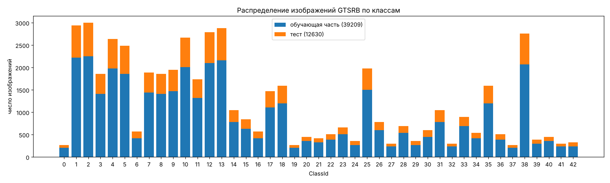
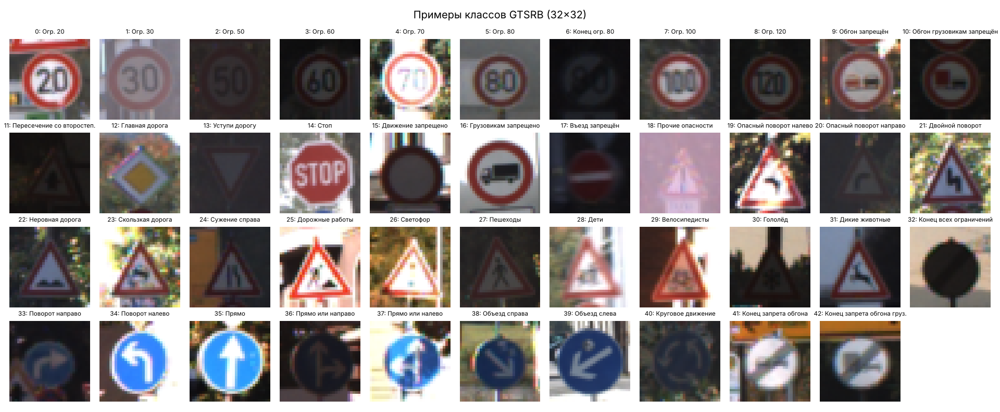

# ЛР2 АЗСИИ: подробный гайд для начинающего

> Атаки уклонения **FGSM** и **PGD** (белый ящик) на классификаторы дорожных знаков **VGG16** и **ResNet50**,
> целевая атака «Стоп» → «Ограничение скорости 30» и перенос атак между моделями (чёрный ящик).

В гайде разобрано всё, что происходит в лабораторной: о чём задание, что нужно знать заранее, как устроены
датасет, модели и атаки, что делает каждый блок ноутбука, где легко ошибиться, как читать результаты и что
отвечать на защите.

Файлы в папке `lab2/`:

| Файл / папка | Что это |
|---|---|
| `LR2_GTSRB_FGSM_PGD.ipynb` | Ноутбук с решением. Уже выполнен, все выводы, таблицы и графики сохранены внутри |
| `GUIDE_LR2.md` | Этот гайд |
| `results/` | CSV со всеми числами: подбор гиперпараметров, история обучения, Таблицы 1–3, перенос атак |
| `images/` | Все картинки из ноутбука (используются в гайде) |
| `.gitignore` | Не даёт закоммитить датасет (`data/`, ~365 МБ) и веса моделей (`checkpoints/`, ~155 МБ) |

---

## Оглавление

1. [О чём задание простыми словами](#1-о-чём-задание-простыми-словами)
2. [Словарик](#2-словарик)
3. [Что нужно понимать до начала](#3-что-нужно-понимать-до-начала)
4. [Датасет GTSRB](#4-датасет-gtsrb)
5. [Модели: VGG16 и ResNet50, transfer learning](#5-модели-vgg16-и-resnet50-transfer-learning)
6. [Обучение и подбор гиперпараметров](#6-обучение-и-подбор-гиперпараметров)
7. [Атаки FGSM и PGD, целевые и нецелевые, белый и чёрный ящик](#7-атаки-fgsm-и-pgd)
8. [Библиотека ART: как ей пользоваться](#8-библиотека-art-как-ей-пользоваться)
9. [Разбор ноутбука блок за блоком](#9-разбор-ноутбука-блок-за-блоком)
10. [Сложные моменты и грабли](#10-сложные-моменты-и-грабли)
11. [Результаты и как их читать](#11-результаты-и-как-их-читать)
12. [Выводы (готовый текст для отчёта)](#12-выводы-готовый-текст-для-отчёта)
13. [Как запустить самому](#13-как-запустить-самому)
14. [Вопросы для защиты (с ответами)](#14-вопросы-для-защиты-с-ответами)
15. [Источники](#15-источники)

---

## 1. О чём задание простыми словами

Беспилотный автомобиль видит дорожный знак через камеру, а нейросеть говорит, что это за знак. Если
злоумышленник сумеет **чуть-чуть** изменить картинку (наклейкой, краской, шумом в сигнале) так, что человек
по-прежнему видит «СТОП», а нейросеть уверенно отвечает «Ограничение скорости 30», машина не остановится.
Это и есть **атака уклонения** (evasion attack): модель уже обучена и работает, а атакующий подаёт ей специально
испорченный вход, чтобы она «уклонилась» от правильного ответа.

Лабораторная состоит из трёх заданий.

1. **Обучить две нейросети** распознавать 43 вида немецких дорожных знаков (датасет **GTSRB**). Сети с нуля не пишем:
   берём **VGG16** и **ResNet50**, заранее обученные на ImageNet, и дообучаем их на знаках (fine-tuning).
   Подбираем гиперпараметры, заполняем **Таблицу 1** (accuracy на обучении, валидации и тесте) и строим графики
   loss и accuracy по эпохам.
2. **Нецелевая атака белого ящика.** Знаем модель целиком и хотим, чтобы она ошиблась хоть как-нибудь.
   Применяем две атаки: **FGSM** (один шаг) и **PGD** (много маленьких шагов) к первым 1000 тестовым картинкам при
   десяти значениях силы атаки ε от 1/255 до 80/255. Заполняем **Таблицу 2**, строим график «accuracy от ε»
   и показываем, как выглядят атакованные картинки. По заданию при ε = 10/255 accuracy должна упасть ниже 60 %.
3. **Целевая атака белого ящика.** Берём все 270 тестовых знаков «Стоп» и добиваемся, чтобы модель называла их
   именно «Ограничение скорости 30». Делаем это методами PGD и FGSM при семи значениях ε, заполняем **Таблицу 3**,
   показываем примеры и сравниваем методы.

Во вводной части задания есть ещё вторая цель: «навыки переноса атак уклонения на основе чёрного ящика».
Отдельного пункта под неё в тексте нет, поэтому в ноутбуке добавлен небольшой раздел **«Дополнительно: перенос атак»**.
Примеры, построенные по градиентам VGG16, подаются в ResNet50, и наоборот. Это ровно та ситуация, когда атакующий
не знает модель-жертву (чёрный ящик) и атакует через свою модель.

---

## 2. Словарик

| Термин | Что значит |
|---|---|
| **Классификатор** | Модель, которая относит вход к одному из классов (здесь 43 класса знаков) |
| **Логиты** | «Сырые» выходы сети, по одному на класс. Предсказание = класс с максимальным логитом (`argmax`) |
| **Функция потерь (loss)** | Число «насколько сеть ошиблась». Здесь кросс-энтропия: `−log p(правильный класс)` |
| **Accuracy** | Доля правильно классифицированных картинок |
| **Эпоха** | Один полный проход по обучающей выборке |
| **Батч** | Порция картинок (здесь 128), по которой делается один шаг оптимизации |
| **Learning rate (lr)** | Размер шага оптимизатора. Слишком большой — обучение «разносит», слишком маленький — учится медленно |
| **Гиперпараметры** | Настройки обучения, которые не учатся сами: оптимизатор, lr, число эпох, размер батча, аугментация |
| **Transfer learning / fine-tuning** | Берём сеть, обученную на большой задаче (ImageNet), меняем последний слой и дообучаем на своей |
| **ImageNet** | Огромный датасет (1,2 млн фото, 1000 классов), на котором предобучены VGG16 и ResNet50 |
| **Train / validation / test** | Обучающая выборка (на ней учимся), валидационная (по ней выбираем гиперпараметры и эпоху), тестовая (только для финальной оценки) |
| **Переобучение (overfitting)** | Модель запоминает обучающие картинки вместо общих закономерностей: train-accuracy высокая, на новых данных хуже |
| **Аугментация** | Случайные искажения обучающих картинок (сдвиг, яркость), чтобы модель не переобучалась |
| **Состязательный пример (adversarial example)** | Картинка, специально изменённая так, чтобы модель ошиблась, хотя человек разницы почти не видит |
| **Атака уклонения (evasion)** | Атака на уже обученную модель через подмену входа (в отличие от отравления данных при обучении) |
| **Белый ящик (white-box)** | Атакующий знает архитектуру и веса и может считать градиенты модели |
| **Чёрный ящик (black-box)** | Атакующий видит только ответы модели (или вообще ничего) и не может считать её градиенты |
| **Перенос атаки (transferability)** | Пример, построенный против одной модели, часто обманывает и другую |
| **Суррогатная модель** | «Своя» модель атакующего, по которой он строит примеры для переноса |
| **Нецелевая атака (untargeted)** | Нужно, чтобы модель ошиблась, а какой класс она выдаст, неважно |
| **Целевая атака (targeted)** | Нужно, чтобы модель выдала **конкретный** класс (здесь «Огр. 30») |
| **ε (эпсилон)** | Максимально допустимое изменение каждого пикселя. ε = 10/255 значит «не больше 10 уровней яркости из 255» |
| **Норма L∞** | Максимум модуля по всем элементам. Ограничение ‖δ‖∞ ≤ ε = «ни один пиксель не изменён больше, чем на ε» |
| **δ (дельта), возмущение** | Разница между атакованной и исходной картинкой: δ = x_adv − x |
| **Градиент по входу ∇ₓL** | Как изменится loss, если чуть-чуть изменить каждый пиксель. Основа FGSM и PGD |
| **sign** | Знак числа: +1, −1 или 0. FGSM берёт знак градиента, а не сам градиент |
| **Проекция** | Возврат точки в допустимую область (ε-окрестность и диапазон [0, 1]) после шага PGD |
| **ART** | Adversarial Robustness Toolbox, библиотека IBM с готовыми атаками и защитами |
| **Seed** | «Зерно» генератора случайных чисел. Один и тот же seed даёт воспроизводимые результаты |

---

## 3. Что нужно понимать до начала

### 3.1. Картинка как тензор

Цветная картинка 32×32 — это массив 32×32×3 чисел (высота × ширина × каналы RGB). В файле пиксели хранятся как
целые 0…255 (`uint8`). Нейросети удобнее числа в [0, 1], поэтому делим на 255.

PyTorch хранит картинки в порядке **каналы, высота, ширина**: `[N, C, H, W]`. Батч из 128 картинок — тензор
`[128, 3, 32, 32]`. NumPy, PIL и matplotlib используют порядок `[H, W, C]`. Отсюда в ноутбуке постоянные
`permute(0, 3, 1, 2)` и `transpose(1, 2, 0)`. Это просто перестановка осей, сами числа не меняются.

### 3.2. Как сеть учится и как её атакуют

Обучение: считаем loss на батче, берём градиент **по весам** `∂L/∂w` и сдвигаем веса так, чтобы loss **уменьшался**.

Атака: веса заморожены. Берём градиент **по картинке** `∂L/∂x` и сдвигаем **пиксели** так, чтобы loss **рос**
(нецелевая атака) или чтобы падал loss для нужного нам класса (целевая атака).

Технически это одна и та же операция `loss.backward()`, только «ручку крутим» у входа, а не у весов.

### 3.3. Почему маленькое изменение всё ломает

Сеть почти линейна на маленьких участках. Если каждый из 3072 пикселей (32·32·3) сдвинуть на крошечное ε в
«правильную» сторону (по знаку градиента), вклады всех пикселей **складываются**: изменение выхода ≈ ε·‖∇‖₁, и при
тысячах входов это много. Человек же видит лёгкий шум, а не сумму. Именно на этом построен FGSM (Goodfellow, 2014).

### 3.4. ε в «единицах яркости»

В этой работе модель принимает картинку в диапазоне [0, 1] (нормализация ImageNet спрятана внутрь модели,
см. раздел 5.3). Поэтому ε читается напрямую:

| ε | В уровнях яркости | Как выглядит |
|---|---|---|
| 1/255 ≈ 0.004 | ±1 из 255 | Глазом не видно совсем |
| 5/255 ≈ 0.02 | ±5 | Практически не видно |
| 10/255 ≈ 0.04 | ±10 | Едва заметная «зернистость» |
| 20/255 ≈ 0.08 | ±20 | Заметный цветной шум |
| 50/255 ≈ 0.2 | ±50 | Сильный шум, знак читается |
| 80/255 ≈ 0.31 | ±80 | Картинка сильно испорчена (это «0.3» из рис. 3 задания) |

### 3.5. `model.eval()` и `model.train()`

В VGG16 (в нашей голове) есть **Dropout**, в ResNet50 — **BatchNorm**. Они ведут себя по-разному при обучении и
при использовании. `model.train()` включает режим обучения (dropout случайно выключает нейроны, BatchNorm считает
статистики по батчу), `model.eval()` включает режим использования (всё детерминировано). Оценка качества и атаки
делаются в режиме `eval()`. ART переключает модель в `eval()` сам.

---

## 4. Датасет GTSRB

**German Traffic Sign Recognition Benchmark** — соревнование 2011 года по распознаванию дорожных знаков.

* **43 класса**: ограничения скорости, запреты, предупреждающие, предписывающие знаки.
* **39 209** обучающих и **12 630** тестовых фотографий, всего ≈ 51 800 (в задании «около 51 000»).
* Исходные размеры разные (от 15×15 до 250×250 пикселей). Задание просит 32×32, поэтому все картинки уменьшаются
  (или увеличиваются) до 32×32 билинейной интерполяцией.
* **Сильный дисбаланс классов**: «Огр. 50» — 2250 обучающих картинок, «Огр. 20» — всего 210 (рис. ниже).
* Знаков «Стоп» (класс 14) в тесте ровно **270**, как и написано в задании 3.





### 4.1. Откуда качаем

С официального сайта авторов (`sid.erda.dk`) три архива:

| Архив | Размер | Что внутри |
|---|---|---|
| `GTSRB_Final_Training_Images.zip` | 263 МБ | Обучающие картинки в 43 папках + в каждой `GT-000XX.csv` с метками |
| `GTSRB_Final_Test_Images.zip` | 85 МБ | 12 630 тестовых картинок в одной папке, **без меток** |
| `GTSRB_Final_Test_GT.zip` | 0,1 МБ | `GT-final_test.csv`: метки для тестовых картинок |

> **Не перепутайте с `torchvision.datasets.GTSRB`.** Встроенный загрузчик torchvision качает архив
> `GTSRB-Training_fixed.zip`, в котором только **26 640** обучающих картинок, а не 39 209. Для задания с «около 51 000
> изображений» и его рис. 1 нужна полная версия, поэтому в ноутбуке свой загрузчик.

На Kaggle есть популярная копия (`meowmeowmeowmeowmeow/gtsrb-german-traffic-sign`), но для неё нужен аккаунт и API-ключ.
Официальные архивы качаются без регистрации.

### 4.2. Треки, или почему validation отделяется «хитро»

Обучающие фото сняты с видео: машина подъезжает к знаку, и камера делает **30 кадров одного и того же знака**.
Такая серия называется **треком**. Имя файла `00012_00029.ppm` означает «трек 12, кадр 29». Всего 1307 треков.

Если отделить validation случайными картинками, кадры одного трека окажутся и в train, и в validation. Модель
фактически увидит validation-картинки при обучении (соседние кадры почти одинаковы), и validation-accuracy будет
**завышенной**. Поэтому в ноутбуке validation — это **20 % треков целиком** (`GroupShuffleSplit` из scikit-learn
с `groups = id трека`). Официальный тест снят на других треках, так что проблема касается только train/validation.

---

## 5. Модели: VGG16 и ResNet50, transfer learning

### 5.1. Зачем предобученные сети

Задание прямо разрешает и рекомендует брать **предобученные на ImageNet** сети и не писать их с нуля. Первые слои
любой свёрточной сети учатся находить края, углы, цветовые пятна, текстуры. Это одинаково полезно для котиков из
ImageNet и для дорожных знаков. Поэтому мы берём уже обученные «глаза» сети и дообучаем их под нашу задачу.
Так получается быстрее и точнее, чем обучать 15–25 млн параметров с нуля на 31 тысяче картинок.

### 5.2. VGG16

VGG16 (Simonyan & Zisserman, 2014): 13 свёрточных слоёв 3×3 и 5 max-pool, затем 3 полносвязных слоя.
Простая и «тяжёлая» по вычислениям сеть.

* Каждый max-pool уменьшает картинку вдвое: 32 → 16 → 8 → 4 → 2 → **1**. На выходе свёрточной части (`features`)
  получается тензор 512×1×1, то есть вектор из 512 чисел.
* Штатный классификатор VGG16 ждёт 512×7×7 = 25 088 чисел и содержит ≈ 120 млн параметров (слои по 4096 нейронов).
  Для картинок 32×32 и 43 классов это перебор, поэтому мы его **выбрасываем** и ставим свою «голову»:
  `Flatten → Dropout(0.5) → Linear(512, 256) → ReLU → Dropout(0.5) → Linear(256, 43)`.
* Итог: **14,9 млн** параметров (почти все в свёрточной части).

Так же делают в Keras: `VGG16(include_top=False, input_shape=(32, 32, 3))` и сверху свой `Dense`.

### 5.3. ResNet50

ResNet50 (He et al., 2015): 50 слоёв, собранных в «остаточные блоки» (residual blocks). Каждый блок считает
`x + F(x)`. «Обходной путь» `+ x` позволяет градиенту проходить через десятки слоёв, поэтому глубокая сеть хорошо
обучается. Внутри много **BatchNorm**.

* Меняем только последний слой `fc`: было `Linear(2048, 1000)` для ImageNet, стало `Linear(2048, 43)`.
* Итог: **23,6 млн** параметров.
* На входе 32×32 ResNet50 тоже сжимает картинку до 1×1 (первая свёртка со stride 2, max-pool и ещё три уменьшения).
  Сеть рассчитана на 224×224, поэтому на 32×32 ей «тесновато», но после дообучения она всё равно хорошо работает.

### 5.4. Нормализация внутри модели (важное решение)

Предобученные сети ждут на входе картинку, нормализованную статистиками ImageNet:
`(x − mean) / std`, `mean = (0.485, 0.456, 0.406)`, `std = (0.229, 0.224, 0.225)`.

Обычно нормализацию делают в загрузчике данных, до модели. Здесь она сделана **первым слоем модели** (класс `Normalize`).
Зачем:

* Модель принимает обычную картинку в [0, 1]. Атаки ART работают в том же пространстве, `clip_values=(0, 1)`
  означает честные границы яркости, и **ε = 10/255 действительно означает 10 уровней яркости**.
* Если бы нормализация была снаружи, ART работал бы с нормализованными числами. Тогда ε = 10/255 соответствовало бы
  примерно 10/255 · 0.225 ≈ 2.3 уровня яркости, а границы клиппинга были бы не 0 и 1, а примерно −2.1 и 2.6.
  Таблицы получились бы несравнимыми с заданием. (В ЛР1 ровно эта путаница и была: там eps задавался
  в нормализованном пространстве.)

---

## 6. Обучение и подбор гиперпараметров

### 6.1. Цикл обучения (`train_model`)

Для каждой эпохи:

1. Перемешиваем обучающую выборку и делим на батчи по 128.
2. Каждый батч: **аугментация** → прямой проход → кросс-энтропия → `backward()` → шаг оптимизатора → шаг
   планировщика lr.
3. После эпохи считаем loss и accuracy на validation и test (функция `evaluate`, режим `eval()`, без аугментации).
4. Если validation-accuracy лучше всех предыдущих, запоминаем копию весов.

После последней эпохи в модель загружаются веса **лучшей по validation** эпохи (аналог `ModelCheckpoint(save_best_only=True)` в Keras).

### 6.2. Аугментация

* **Случайный сдвиг до ±3 пикселей**: картинку дополняем по краям повтором крайних пикселей (`replicate`) и вырезаем
  случайное окно 32×32. Знак на фото бывает не точно по центру.
* **Случайные яркость и контраст ±20 %**: фото сняты днём, в сумерках, на солнце.
* **Горизонтальных отражений нет!** Для котиков отражение — стандартная аугментация, а для знаков это ошибка:
  отражённый «Поворот налево» (класс 34) — это «Поворот направо» (класс 33), «Опасный поворот налево» превращается
  в «направо», цифры на ограничениях скорости становятся зеркальными. Модель учили бы неправильным меткам.

### 6.3. Оптимизаторы и lr

* **Adam**: адаптивный оптимизатор, для каждого веса подбирает свой шаг. Обычно хорошо работает «из коробки» с lr около 1e-3…1e-4.
* **SGD с моментом 0.9 (Nesterov)** и weight decay 5e-4: классика для свёрточных сетей, обычно с lr около 1e-2.
* **CosineAnnealingLR**: lr плавно уменьшается от начального до нуля по косинусу за всё обучение. В начале шаги
  крупные (быстро учимся), в конце мелкие (аккуратно «доводим» веса).

### 6.4. Подбор гиперпараметров

Задание требует «поиск наилучших гиперпараметров». Честный полный перебор (каждую конфигурацию учить до конца)
на CPU занял бы десятки часов, поэтому используется стандартный быстрый вариант:

* сетка из 4 конфигураций: Adam lr = 1e-3, 3e-4, 1e-4 и SGD lr = 1e-2;
* каждая конфигурация учится **2 эпохи на случайных 8000** обучающих картинках;
* сравниваем по **validation-accuracy**; тестовая выборка в подборе не участвует;
* лучшая конфигурация используется для полного обучения (6 эпох на всех 31 тысяче обучающих картинок).

Почему перебираем именно оптимизатор и lr: при fine-tuning они влияют на результат сильнее всего. Слишком большой lr
«ломает» предобученные веса (сеть забывает ImageNet раньше, чем выучит знаки), слишком маленький не успевает
перестроить сеть за пару эпох. Размер батча, число эпох и силу аугментации тоже можно перебирать, если есть время на GPU.

### 6.5. Как читать train-кривые на графиках

Train-loss и train-accuracy на графиках — это **средние за эпоху** по **аугментированным** батчам при **включённом
Dropout**, причём веса в течение эпохи ещё меняются. Validation и test считаются на чистых картинках в режиме `eval()`
уже **после** эпохи. Поэтому на первой эпохе train-accuracy заметно **ниже** validation (в начале эпохи сеть ещё ничего
не умела, а среднее это помнит). Это нормально и не ошибка. С третьей-четвёртой эпохи train обгоняет validation: модель
начинает запоминать обучающие картинки, и расхождение показывает степень переобучения.

Для честного сравнения в **Таблице 1** accuracy на обучающей выборке пересчитывается отдельно, так же как для остальных
выборок: чистые картинки, режим `eval()`.

---

## 7. Атаки FGSM и PGD

### 7.1. FGSM — Fast Gradient Sign Method

Goodfellow, Shlens, Szegedy, «Explaining and Harnessing Adversarial Examples», 2014.

**Нецелевой вариант:**

```
x_adv = clip_[0,1]( x + ε · sign(∇ₓ L(f(x), y_true)) )
```

* Считаем градиент loss по картинке **один раз**.
* Каждый пиксель сдвигаем ровно на ±ε в ту сторону, где loss растёт.
* Обрезаем результат до [0, 1].

Плюсы: очень быстро (один прямой и один обратный проход). Минусы: это один шаг по **линейному приближению**.
Если граница класса «изогнута», шаг может перелететь, промахнуться или упереться не туда. При больших ε FGSM
иногда даже хуже, чем при средних (подробнее в разделе 11).

**Целевой вариант** (класс-цель `t`):

```
x_adv = clip_[0,1]( x − ε · sign(∇ₓ L(f(x), t)) )
```

Знак **минус**: мы **уменьшаем** loss относительно целевого класса, то есть двигаем картинку к нему.

### 7.2. PGD — Projected Gradient Descent

Madry et al., «Towards Deep Learning Models Resistant to Adversarial Attacks», 2017.

PGD — это FGSM, повторённый много раз маленькими шагами с **проекцией**:

```
x⁰ = x                                  (или x + случайный шум в ε-шаре)
повторить max_iter раз:
    x' = xᵗ + α · sign(∇ₓ L(f(xᵗ), y))   # маленький шаг FGSM размера α
    x' = clip(x', x − ε, x + ε)          # проекция в ε-окрестность исходной картинки (L∞-шар)
    xᵗ⁺¹ = clip(x', 0, 1)                # проекция в допустимый диапазон пикселей
```

* После каждого шага заново считается градиент **в новой точке**, поэтому PGD «следует изгибам» границы класса.
* Проекция гарантирует, что итоговое возмущение не превышает ε, то есть сравнение с FGSM при том же ε честное.
* PGD считается **самой сильной атакой первого порядка** (использующей только градиенты), поэтому её используют
  как эталон при проверке стойкости.

Параметры в ноутбуке:

| Параметр | Значение | Почему |
|---|---|---|
| `norm` | `np.inf` | Ограничение L∞, как в задании |
| `max_iter` | 10 (задание 2), 20 (задание 3) | Целевой атаке нужно больше шагов: попасть в конкретный класс труднее, чем просто ошибиться |
| `eps_step` (α) | 2.5·ε / max_iter | Правило Madry: суммарный путь 2.5ε, чтобы дойти до границы ε-шара и «походить» вдоль неё |
| `num_random_init` | 0 | Старт из исходной картинки, без случайного шума: результаты воспроизводимы |

Цена: PGD в `max_iter` раз дороже FGSM (10 и 20 проходов вместо одного).

### 7.3. Целевая и нецелевая

| | Нецелевая | Целевая |
|---|---|---|
| Цель | Любой неправильный ответ | Конкретный класс `t` |
| Направление шага | Увеличить `L(f(x), y_true)` | Уменьшить `L(f(x), t)` |
| В ART | `targeted=False`, в `generate` передаём **истинные** метки | `targeted=True`, в `generate` передаём **целевые** метки |
| Метрика успеха | Падение accuracy | Доля примеров, отнесённых к классу `t` |
| Сложность | Проще: подходит любой соседний класс | Сложнее: нужно попасть в один конкретный класс из 43 |

### 7.4. Маскировка градиента: почему атака может «притворяться» слабой

Это самый коварный момент лабораторной, и в первом прогоне ноутбука он действительно сработал.

**Что произошло.** В первой версии ноутбука атаки получали обычную `nn.CrossEntropyLoss()`. Для ResNet50 всё было как
ожидалось: PGD при ε = 10/255 оставлял 1,5 % accuracy. А VGG16 выглядела «бронированной»: FGSM при ε = 10/255 давал
**60,3 %** (задание требует меньше 60 %), а PGD даже при огромном ε = 80/255 оставлял **19 %**. Белая атака с ε = 80/255
может перекрасить картинку почти как угодно, так что 19 % — явный признак, что атака сломана, а не модель стойкая.

**Причина.** Кросс-энтропия считается через softmax: `p_y = exp(z_y) / Σ exp(z_j)`. Градиент по логитам равен `p − onehot(y)`.
Дообученная VGG16 очень уверена: логит правильного класса больше второго в среднем на **21** единицу (максимум около 70).
`exp(−21) ≈ 7·10⁻¹⁰`, а точность float32 — около 10⁻⁷. Поэтому `p_y` округляется до **ровно 1.0**, компонента
градиента `p_y − 1` становится ровно нулём, и от градиента остаются только крошечные `p_j ≈ 10⁻¹⁰` других классов,
искажённые ошибками округления. Атака получает плохое направление. Это называется **маскировкой градиента**
(gradient masking, Athalye et al., 2018, «Obfuscated Gradients Give a False Sense of Security»): модель кажется стойкой,
но только потому, что сломан инструмент измерения.

**Проверка.** Те же атаки на первых тестовых картинках VGG16 (300 для FGSM, 200 для PGD), отличается только то, как
считается loss:

| Атака на VGG16 | CE в float32 | Та же CE в float64 | Margin loss (C&W) |
|---|---|---|---|
| FGSM ε = 10/255 | 61,3 % | 27,3 % | 24,3 % |
| PGD ε = 10/255 | 49,5 % | 13,5 % | 0,0 % |
| PGD ε = 80/255 | 20,0 % | 5,5 % | 0,0 % |

**Решение в ноутбуке.** Класс `StableCrossEntropy` — та же кросс-энтропия, но логиты перед ней переводятся в float64
(`logits.double()`). Там точности хватает (около 10⁻¹⁶), softmax не насыщается, градиент правильный. Определение FGSM и PGD
при этом **не меняется**: это тот же loss, просто посчитанный точно. Класс наследуется от `nn.CrossEntropyLoss`, чтобы ART
продолжал передавать метки как номера классов.

Другие известные способы: делить логиты на «температуру» (`CE(z / T)`, например T = 20) или атаковать по margin-loss
Carlini–Wagner `max_{j≠y} z_j − z_y`: у неё нет softmax, поэтому насыщаться нечему. В ноутбуке выбран float64, потому что
это та же функция потерь, что в задании.

В разделе 2.0 ноутбука это показано наглядно: таблица сравнивает FGSM при ε = 10/255 с обычной и с устойчивой
кросс-энтропией для обеих моделей.

**Урок на будущее:** если атака белого ящика при большом ε не доводит accuracy почти до нуля, сначала ищите ошибку в атаке
(насыщение, `eval()`/`train()`, клиппинг, неверные метки), а не радуйтесь стойкости модели.

### 7.5. Белый и чёрный ящик, перенос

* **Белый ящик**: задания 2 и 3. Атака считает градиенты той же модели, которую атакует.
* **Чёрный ящик через перенос**: атакующий строит пример по градиентам **своей** (суррогатной) модели и подаёт его
  **чужой**. Работает потому, что разные сети, обученные на одних данных, выучивают похожие признаки и похожие
  «слабые места». В ноутбуке суррогат — VGG16, жертва — ResNet50, и наоборот.

---

## 8. Библиотека ART: как ей пользоваться

**Adversarial Robustness Toolbox** (IBM, сейчас проект Linux Foundation AI) — самая полная библиотека атак и защит,
её рекомендует задание. Работает с PyTorch, TensorFlow/Keras, scikit-learn и другими фреймворками через общий интерфейс.

Схема всегда одна:

```python
from art.estimators.classification import PyTorchClassifier
from art.attacks.evasion import FastGradientMethod, ProjectedGradientDescent

# 1. Оборачиваем модель
clf = PyTorchClassifier(model=model, loss=nn.CrossEntropyLoss(),
                        input_shape=(3, 32, 32), nb_classes=43, clip_values=(0.0, 1.0))

# 2. Создаём атаку
attack = FastGradientMethod(clf, norm=np.inf, eps=8/255)

# 3. Генерируем атакующие примеры (x — numpy float32 [N, 3, 32, 32] в [0, 1], y — one-hot)
x_adv = attack.generate(x=x, y=y_onehot)

# 4. Оцениваем
acc = (clf.predict(x_adv).argmax(1) == y_true).mean()
```

Что нужно знать:

* **Вход ART — NumPy, не torch.** `clf.predict` и `attack.generate` принимают и возвращают `np.ndarray`.
  Формат как у модели: `[N, C, H, W]`, `float32`.
* `clip_values=(0, 1)` — допустимый диапазон пикселей. Атаки обрезают результат по нему.
* `input_shape` указывается **без** размера батча.
* `y` можно передавать как индексы классов или как one-hot; ART сам приведёт к one-hot. В ноутбуке one-hot сделан явно
  (`np.eye(43)[y]`), чтобы было видно, что происходит.
* **Если не передать `y` в нецелевую атаку**, ART возьмёт в качестве «правильных» меток предсказания модели. Это защищает
  от эффекта «утечки меток» (label leaking), но тогда атака двигает картинку от **предсказанного** класса, а не от
  истинного. В ноутбуке передаются **истинные** метки, и accuracy тоже считается по истинным меткам.
* Для целевой атаки в `y` передаются **целевые** метки (здесь везде класс 1).
* `batch_size` в атаке влияет только на скорость и память, не на результат.
* Модель для ART должна возвращать **логиты** (без softmax): `CrossEntropyLoss` сам применит log-softmax.
* Параметр `loss` — та функция, по которой атаки считают градиент. В ноутбуке это `StableCrossEntropy` (раздел 7.4).
  ART смотрит, является ли loss экземпляром `nn.CrossEntropyLoss`, и если да, передаёт в него метки как номера классов,
  а не one-hot. Поэтому собственный loss лучше наследовать от `nn.CrossEntropyLoss`.

Аналог в Keras/TensorFlow — `TensorFlowV2Classifier` / `KerasClassifier`, дальше всё то же самое.

---

## 9. Разбор ноутбука блок за блоком

Ноутбук `LR2_GTSRB_FGSM_PGD.ipynb` идёт строго по заданию. Ниже то, что делает каждый блок и на что обратить внимание.

### Раздел 0. Окружение

**Ячейка установки ART.** В Colab и Kaggle из нужного нет только `adversarial-robustness-toolbox`. Ячейка проверяет,
импортируется ли `art.attacks`, и ставит пакет через `pip`, только если его нет. Типичная ошибка без этой ячейки:
`ModuleNotFoundError: No module named 'art'`. Обратите внимание: пакет на pip называется
`adversarial-robustness-toolbox`, а `pip install art` поставит совсем другую библиотеку (ASCII-арт).

**Импорты и параметры.** Все «ручки» эксперимента собраны в одном месте:

| Параметр | Значение | Смысл |
|---|---|---|
| `IMG_SIZE` | 32 | Размер картинок из задания |
| `BATCH_SIZE` | 128 | Батч для обучения |
| `EPOCHS` | 6 | Эпох финального обучения. На GPU можно увеличить до 10–15 |
| `HP_SUBSET`, `HP_EPOCHS` | 8000, 2 | Размер подвыборки и число эпох для подбора гиперпараметров |
| `RETRAIN` | False | Если веса уже есть в `checkpoints/`, обучение пропускается (см. грабли) |
| `N_ATTACK` | 1000 | «Первые 1000 изображений тестового множества» |
| `PGD_ITERS`, `PGD_ITERS_T` | 10, 20 | Итерации PGD для заданий 2 и 3 |

`set_seed` фиксирует генераторы случайных чисел Python, NumPy и PyTorch. `DEVICE` выбирается сам: GPU, если есть, иначе
CPU (тогда PyTorch использует все ядра).

**Список `CLASS_NAMES`.** Русские названия 43 классов, индекс = ClassId. Нужен только для подписей на картинках.

### Раздел 1. Датасет

**Скачивание.** `urllib.request.urlretrieve` качает три архива в `data/`, если их там ещё нет.

**Чтение и кэш.** Функции `load_train` и `load_test` читают `.ppm` **прямо из zip**, без распаковки на диск
(`zipfile.ZipFile.open`). Каждая картинка уменьшается до 32×32 (`read_image`). Для обучающей части метки берутся из
`GT-000XX.csv` в папке каждого класса, для тестовой — из `GT-final_test.csv`. Заодно для каждой обучающей картинки
запоминается **id трека**: `класс·1000 + номер трека` (номера треков повторяются в разных классах, поэтому добавлен класс).

Результат сохраняется в `data/gtsrb_32.npz`. Повторный запуск грузит его за секунду вместо ~30 секунд чтения 52 тысяч файлов.

Проверочный вывод: 39 209 + 12 630 = 51 839 картинок, 1307 треков, 270 знаков «Стоп» в тесте.

**Распределение по классам** — столбчатая диаграмма (аналог рис. 1 задания), сохраняется в `images/class_distribution.png`.
**Примеры классов** — сетка из 43 картинок, по одной на класс.

**Разбиение.** `GroupShuffleSplit(test_size=0.2)` с `groups=tracks_all` отделяет 20 % треков в validation. `assert` проверяет,
что ни один трек не попал в обе части. Затем массивы превращаются в тензоры `uint8` формы `[N, 3, 32, 32]`.
В `float` они переводятся **по батчам** (в `batches`): так в памяти лежит 4-кратно меньше данных.

### Задание 1. Обучение

**Модели (`Normalize`, `build_vgg16`, `build_resnet50`).** См. раздел 5. Проверочный вывод показывает число параметров
и то, что на выходе действительно 43 логита.

**Функции обучения.**

* `batches` — генератор батчей, переводит `uint8` в `float` в [0, 1].
* `augment` — сдвиг и яркость/контраст (раздел 6.2). Параметры случайные **для каждой картинки** отдельно.
* `evaluate` — средний loss и accuracy в режиме `eval()` под `torch.no_grad()` (градиенты не нужны, так быстрее).
* `make_optimizer` — Adam или SGD.
* `train_model` — основной цикл (раздел 6.1). Возвращает `DataFrame` с историей по эпохам.

**Подбор гиперпараметров.** Перебор `HP_GRID` для обеих моделей. Каждая конфигурация стартует со свежей предобученной сети
(`build()` внутри цикла) и одинакового seed, чтобы сравнение было честным. Результаты сохраняются в
`results/hparam_search.csv`, лучшие параметры кладутся в `BEST_HP`.

**Финальное обучение.** Для каждой модели: если есть `checkpoints/<модель>.pt` и история и `RETRAIN = False`, всё
загружается с диска; иначе модель учится `EPOCHS` эпох с `BEST_HP`. Веса сохраняются в `checkpoints/`, история — в
`results/history_<модель>.csv`.

**Графики (аналог рис. 2).** Для каждой модели два графика: loss и accuracy по эпохам для обучения, валидации и теста.

**Таблица 1.** `evaluate` на трёх выборках, accuracy в процентах. Отдельно выводится loss.

### Задание 2. Нецелевые атаки

**`StableCrossEntropy` и `make_art_classifier`.** Первая — кросс-энтропия в float64 (раздел 7.4), вторая оборачивает
модель в `PyTorchClassifier` (раздел 8) с этой функцией потерь. Параметр `loss` у `make_art_classifier` нужен только для
демонстрации в п. 2.0: туда передаётся обычная `nn.CrossEntropyLoss()` для сравнения.

**Данные для атаки.** `x_att` — первые 1000 тестовых картинок в формате ART (`float32`, `[N, 3, 32, 32]`, [0, 1]),
`y_att` — их метки, `y_att_onehot` — те же метки в one-hot. Сначала печатается accuracy на этих 1000 картинках без атаки:
это «Исходные изображения» в Таблице 2.

**2.0. Проверка маскировки градиента.** Для каждой модели считаются: медианный отрыв логитов (насколько модель
уверена), доля картинок, у которых softmax в float32 выдаёт ровно 1.0, и accuracy после FGSM при ε = 10/255 с обычной
и с устойчивой кросс-энтропией. Таблица сохраняется в `results/gradient_masking_check.csv`.

**`make_attack`** — фабрика атак. Для FGSM: `FastGradientMethod(norm=inf, eps)`. Для PGD:
`ProjectedGradientDescent(norm=inf, eps, eps_step=2.5·eps/iters, max_iter=iters)`. Флаг `targeted` используется в задании 3.

**Главный цикл.** Для каждой модели, атаки (FGSM, PGD) и ε из `[1, 2, 3, 4, 5, 8, 10, 20, 50, 80]/255`:

1. генерируем 1000 атакующих примеров по градиентам атакуемой модели;
2. считаем accuracy атакуемой модели на них (белый ящик);
3. считаем accuracy **второй** модели на тех же примерах (перенос, чёрный ящик);
4. проверяем `max|δ|`: оно должно быть ровно ε (контроль, что ART делает то, что мы думаем);
5. для FGSM при ε ∈ {1, 5, 10, 50, 80}/255 сохраняем атакующие версии трёх картинок для рисунка.

Всё складывается в `results/untargeted_attacks.csv`.

**Таблица 2** собирается из этого CSV функцией `acc_at`. Ниже выводится полная таблица по всем 10 значениям ε и
проверка требования «accuracy < 60 % при ε = 10/255».

**Графики accuracy от ε (аналог рис. 3).** Для каждой модели кривые FGSM и PGD, пунктиром — accuracy без атаки и порог 60 %.
Второй график — все кривые вместе в логарифмической шкале по ε: так лучше видна область малых ε, где и происходит всё самое интересное.

**Примеры FGSM (аналог рис. 4).** Для каждой модели три картинки: исходная и пять атакованных версий. Над картинкой —
предсказанный класс; зелёный цвет означает правильный ответ, красный — ошибку.

**Дополнительно: перенос.** Таблица и график accuracy модели-жертвы на примерах, построенных по другой модели.

### Задание 3. Целевая атака

**Подготовка.** `stop_idx` — индексы 270 знаков «Стоп» в тесте, `x_stop` — сами картинки, `y_target` — one-hot класса 1
для всех 270.

**Цикл.** Для каждой модели, метода (PGD с 20 итерациями, затем FGSM) и ε из `[1, 3, 5, 10, 20, 50, 80]/255`:
генерируем `targeted=True`-атаку и считаем две доли:

* `stop_rate` — сколько картинок модель всё ещё называет «Стоп» (accuracy по истинной метке);
* `target_rate` — сколько картинок модель называет «Огр. 30» (успех целевой атаки).

Они **не обязаны** давать в сумме 100 %: часть картинок может уйти в третий класс.

**Таблица 3** — для каждой модели: колонки PGD (требование задания) и FGSM (для шага 2, сравнение).
**График** — обе доли от ε для PGD и FGSM.

**Примеры (аналог рис. 5).** Пять знаков «Стоп» и их атакующие версии PGD и FGSM при ε = 5, 10, 20/255.
Цвет подписи: зелёный — модель всё ещё видит «Стоп», красный — цель достигнута («Огр. 30»), оранжевый — какой-то третий класс.

**Возмущение δ.** Последний рисунок показывает δ = x_adv − x, усиленное в 12 раз (иначе его не видно). Видно, что FGSM
даёт «шахматный» шум ±ε почти во всех пикселях, а PGD — более структурированный узор.

### Выводы

Последняя markdown-ячейка — выводы по всем трём заданиям с конкретными числами (они же в разделе 12 этого гайда).

---

## 10. Сложные моменты и грабли

1. **Маскировка градиента из-за кросс-энтропии в float32 (главная ловушка).** Уверенная VGG16 даёт softmax = 1.0 ровно,
   градиент почти исчезает, и FGSM/PGD выглядят слабыми: в первом прогоне VGG16 при ε = 10/255 держала 60 % под FGSM и
   19 % под PGD даже при ε = 80/255. Лечится расчётом той же кросс-энтропии в float64 (`StableCrossEntropy`). Подробно в разделе 7.4.
2. **`torchvision.datasets.GTSRB` — не полный датасет.** Встроенный загрузчик качает 26 640 обучающих картинок вместо
   39 209 (архив `GTSRB-Training_fixed.zip`). Вроде бы мелочь, но рис. 1 и «около 51 000» из задания с ним не сходятся.
   В ноутбуке свой загрузчик официальных архивов.
3. **Треки и утечка в validation.** См. раздел 4.2. Случайное разбиение по картинкам даёт завышенную validation-accuracy
   (обычно близкую к 100 %), и подбор гиперпараметров по ней почти ничего не говорит. Решение — `GroupShuffleSplit` по трекам.
4. **Горизонтальное отражение в аугментации запрещено.** Оно меняет смысл знака (налево ↔ направо). Это стандартная
   ошибка, когда копируют аугментацию из примеров для CIFAR/ImageNet.
5. **Где делать нормализацию.** Если нормализовать снаружи модели, ε в ART окажется в нормализованном пространстве, и
   «ε = 10/255» будет означать совсем другое (раздел 5.4). Нормализация внутри модели решает это раз и навсегда.
6. **Штатная голова VGG16 на 32×32.** torchvision-VGG16 содержит `AdaptiveAvgPool2d(7, 7)`: он «растянет» карту 1×1
   до 7×7, и сеть формально заработает, но в классификаторе будет 120 млн почти бесполезных параметров и обучение станет
   очень медленным. Поэтому берётся только `features` и своя маленькая голова.
7. **Тест не участвует в выборе.** Лучшая эпоха и лучшие гиперпараметры выбираются по validation. Если выбирать по тесту,
   тестовая accuracy становится оптимистичной (мы «подогнали» модель под тест). Тест на графиках только наблюдаем.
8. **Train-accuracy на первой эпохе ниже validation** — нормально, см. раздел 6.5.
9. **ART ждёт NumPy в формате `[N, C, H, W]`.** Если подать `[N, H, W, C]` (как в Keras или после `np.asarray(PIL)`),
   будет ошибка формы или, хуже, модель молча получит перепутанные оси. Отсюда `transpose(0, 3, 1, 2)`.
10. **Целевые метки, а не истинные.** В целевой атаке в `generate(y=...)` передаются метки **цели** (класс 1). Если
   передать истинные (класс 14) с `targeted=True`, атака будет **притягивать** картинку к «Стоп», то есть сделает её ещё
   «стоповее».
11. **`eps_step` у PGD.** Значение ART по умолчанию `eps_step=0.1` при ε = 1/255 означает шаг в 25 раз больше всего
    допустимого ε: каждый шаг сразу упирается в границу, и PGD вырождается в «FGSM, повторённый 10 раз». Шаг нужно
    задавать относительно ε (здесь 2.5·ε/max_iter).
12. **`max_iter` по умолчанию в ART равен 100.** На CPU это 1000 картинок × 100 итераций × 10 значений ε × 2 модели,
    то есть много часов. 10 итераций с правильным шагом дают почти тот же результат за минуты.
13. **FGSM при больших ε может стать «хуже».** Accuracy под FGSM не обязана монотонно падать с ростом ε: один большой шаг
    по линейному приближению «перелетает» через область ошибки или приводит в класс, который модель угадывает случайно.
    Для целевой атаки это видно особенно ярко. PGD этим почти не страдает. Это не баг, а свойство метода (раздел 11).
14. **`stop_rate + target_rate ≠ 100 %`.** Картинка может уйти в третий класс (например, «Огр. 50» или «Движение
    запрещено»). Для целевой атаки это неудача, хотя модель и ошиблась.
15. **`RETRAIN = False` и старые веса.** Если вы поменяли модель или гиперпараметры, а в `checkpoints/` лежат старые веса,
    ноутбук **загрузит старые** и не будет учить заново. То же с `results/hparam_search.csv`. После изменений ставьте
    `RETRAIN = True` или удаляйте `checkpoints/` и `results/`.
16. **Скорость на CPU.** VGG16 на 32×32 обучается примерно 95 картинок/с на 4 ядрах, то есть ~6 минут на эпоху.
    В Colab с GPU T4 то же самое занимает секунды. Ноутбук рассчитан так, чтобы полностью пройти на CPU примерно за
    1,5–2 часа (подробнее в разделе 13).
17. **Воспроизводимость.** Seed фиксирован, но на GPU (cuDNN) и при другом числе потоков CPU результаты могут
    отличаться в десятых долях процента. Это нормально.

---

<!--RESULTS-->
